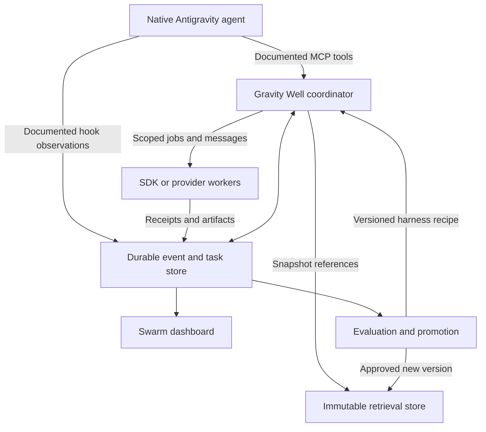

# Gravity Well Harness — Repository Review and Implementation Roadmap

**Review date:** 7 November 2026 (UTC).  
**Reviewed repository:** [BaiTian6641/Gravity-Well-Harness][R0], commit `c619f9dd4212b892c372f9491a2ce7b2e8be1c8a`, package version 1.1.0.  
**Harness² reference:** [google-research/harness2][H0], commit `6868817518876de8fd170c6a8354daca273b6191`.  
**Status:** Review and proposed implementation plan. This review does not claim that the repairs below have been implemented or that a live Antigravity installation was tested.

## 1. Recommendation

Continue the project, but make its next release a trustworthy execution foundation. The repository contains useful components: a Markdown knowledge store, local retrieval, plugin assets, a dashboard, provider transport code, and an attempt to formalize experiment evidence. Several advertised capabilities, however, are simulations, incomplete connections, or integrations with undocumented host internals. These defects directly undermine the desired self-improvement loop.

The intended product should have two cooperating parts:

1. **An Antigravity extension layer:** documented rules, skills, MCP tools, lifecycle hooks, and supported App plugin/background-process sidecar facilities. The process-sidecar contract is distinct from the unverified custom sidepane UI contract. This lets the native agent use Gravity Well's knowledge, task state, and worker services.
2. **A Gravity Well execution service:** owns its jobs, workspaces, event log, provider credentials, RAG snapshots, evaluations, and dashboard. Its autonomous workers use the public Antigravity Python SDK or independently authorized model-provider APIs.

The distinction matters. Google's current FAQ says that the consumer CLI's headless mode is intended for direct scripts and CI, and that embedding it inside third-party coding agents or applications is unsupported. A public command is therefore not sufficient authorization for a Gravity Well worker backend. Use independent API credentials; keep the native Antigravity account inside the host. [A1][A2]

Do not make “more autonomous” mean “more willing to declare success.” The next system must prove that an executor ran, that the requested behavior exists, that messages reached their intended recipients, and that learned advice came from real outcomes.

### Deliverables accompanying this review

| Document | Purpose |
| --- | --- |
| [02_Antigravity_Public_API_Integration_Repair.md](02_Antigravity_Public_API_Integration_Repair.md) | Public-interface capability boundaries, specific integration replacements, migration and release checks |
| [03_gravity_well_default.md](03_gravity_well_default.md) | Ready-to-copy engineering operating rule addressing incomplete implementation, wiring, verification, and context recovery |
| [04_Argon_Context_Resilience.md](04_Argon_Context_Resilience.md) | Evidence on compaction, default-rule deployment, durable context design, and evaluation of completion quality |

## 2. What was reviewed and what was actually tested

The review covered the three principal runtime modules, the MCP server, Python adapter, setup paths, plugin hooks, sidecar server/UI, package manifests, stage documents, and existing tests. The source commit was compared with the public upstream Harness² implementation and current official Antigravity documentation.

The Node suite ran from an isolated repository copy. Focused reproductions imported the reviewed checkout but operated on temporary workspaces and synthetic home/configuration state. External requests were intercepted or blocked; HTTP checks used loopback. No real API credentials were used. The application source was unchanged; the test environment was instrumented to prevent accidental external access. The installer was not run against a user's configuration.

| Check | Observed result | What it establishes |
| --- | --- | --- |
| Existing Node test suite | **8 passed, 0 failed**, approximately 1.68 seconds | Current local assertions pass under isolation; it does not establish native host or live provider conformance |
| Requested-artifact experiment | Harness loop returned success and a 0.95 verification score; requested file did not exist | “Verified” can be computed without doing the work |
| Impossible-task experiment | Success, 0.90 score, and an active lesson, with no provider request | False evidence can enter future retrieval |
| Snapshot experiments | Five independent isolation failures reproduced | A timestamp/document-ID lock is not a frozen input |
| Message experiments | Wrong recipient delivery; one-consumer broadcast; one of two concurrent messages lost | Current bus cannot provide dependable swarm communication |
| Credential-origin experiment | Synthetic global credential attached to a workspace-selected untrusted URL; request intercepted locally | Configuration crosses the credential's intended trust boundary |
| Monitor function experiment | Empty input generated agents, steps and token counts; advancing time changed them | Some displayed telemetry is synthetic |
| Local HTTP fallback experiment | Unauthenticated GET and foreign-Origin text/plain POST reached a harmless mutation handler | Method/authentication/origin checks are absent in that path; browser exploitability was not tested |
| Package dry run | Sidecar tarball omitted two modules imported at startup | Source-folder installation masks a distribution defect |
| Upstream Harness² demo | Two tasks completed; demo recorded 28 executions and 32 editor calls | Upstream's deterministic demo exercises actual executable artifacts; this is not a live-model benchmark |

No installed Antigravity App/standalone IDE session, paid provider, native UI integration, or production workload was exercised. Retrieval accuracy, Argon-versus-other-model quality, benchmark rankings, and claimed token savings were not measured. These limits should remain visible in release documentation.

## 3. Current capability assessment

| Goal | Present implementation | Assessment |
| --- | --- | --- |
| Native integration | Plugin assets and hooks, plus private language-server RPC and global transcript discovery | Public parts are reusable; undocumented dependencies must be removed |
| Swarm visualization | Graphs and formation views, partly generated state and estimated numbers | UI scaffold exists; reliable observability remains incomplete |
| Swarm control | Local lifecycle annotations and model calls | Start/recall/finish controls do not consistently control actual workers |
| Context conveyance | JSON message bus and hook injection | Routing, acknowledgment, concurrency, and scope are defective |
| Harness² | Formula-based JavaScript loop and a bespoke Python executor | Not a compatible implementation of pinned upstream execution contracts |
| RAG | Markdown indexing, BM25-like scoring and feature-hash similarity | Useful baseline; advertised semantic/backend behavior exceeds implementation |
| Third-party models | Several HTTP branches and a model catalog | Some transports exist; complete tool-using worker execution and honest failures are missing |
| Self-improvement | Experience files, manifests, and promotion tools | Unsafe to trust while simulated/unverified evidence can become active guidance |
| Installation | Recursive copying, configuration edits, attempted live activation | Requires packaging, truthful health checks, preservation and rollback |

These conclusions come from the code and reproductions described below, rather than from the stage documents' completion labels. [R1][R2][R3][R4][R5]

## 4. Findings and required repairs

**Priority convention:** P0 blocks a trustworthy release; P1 is required for the intended functional product; P2 improves maintainability or breadth. These are project priorities, not formal vulnerability scores.

### F01 — P0: Harness² success and efficiency are calculated instead of observed

`runHarness2Loop()` creates candidate templates, assigns baseline/candidate token counts and verification scores from formulas, and selects a winner. A branch mode is recorded without creating an isolated branch. A successful response does not depend on the requested artifact existing. Its default recording path turns the result into active knowledge. [R1]

In one isolated check, the loop reported a 0.95 passing score and 10,940 total tokens while the requested `AUDIT_REQUIRED_ARTIFACT.txt` was absent. In another, an impossible mathematical task produced an active experience and zero provider requests; a later unrelated run retrieved that experience and received an even higher formula-derived score.

**Repair:** immediately segregate this behavior into an explicitly selected simulation fixture, with `synthetic: true` and no production promotion. Require execution receipts and actual evaluator output for real results. Unknown usage is null/unavailable. A failed or missing evaluator is not a passing grade.

**Acceptance:** a task requiring a file fails unless that file is produced and checked. No execution means no measured usage, savings, or active lesson. A deliberately failing task cannot become successful because its prompt includes favorable words.

### F02 — P0: Failed providers and empty search results can become successful-looking output

The model hub catches failures and falls into a deterministic cooperative answer with `ok: true`. Native-model catalog entries also use this fallback without invoking Antigravity. Requested peer delegation is skipped by successful live transport branches. Search can manufacture a reference when no provider returned one. [R2]

**Repair:** separate `succeeded`, `unsupported`, `unauthorized`, `rate_limited`, `timed_out`, `failed`, and `simulated`. Preserve redacted upstream errors. Reject unknown model identifiers. Put delegation in the coordinator, independent of transport success. Search must return real results or an honest empty/error outcome.

**Acceptance:** missing credentials required by the selected provider, 401, 429, timeout, malformed payload and unsupported native models never yield production success. A live response with delegated work has a real peer receipt. No retrieved source means no citation. Credential-free local runtimes remain valid when explicitly configured.

### F03 — P0: Knowledge snapshots are not immutable or safely scoped

Snapshots store eligible IDs but read current file bytes and current index state. Explicit missing snapshots can silently become unrestricted reads. A traversal-shaped ID can resolve a different JSON file. Truncated generated document IDs collide. One shared active lock can be replaced or released by another run. All five behaviors were reproduced. [R6][R6b][R6c]

**Repair:** content-addressed source blobs and versioned immutable indexes; opaque validated snapshot IDs; no fallback when an explicit snapshot is invalid; globally unique document IDs; per-run ownership and compare-and-swap release. Every query, get, listing and resource read must use the same snapshot rules. Isolate the candidate's filesystem separately.

**Acceptance:** post-freeze file changes and index rebuilds cannot affect old reads; malformed/missing snapshots fail closed; concurrent experiments cannot alter each other's inputs or release each other's leases.

### F04 — P0: Messages leak across recipients and disappear under concurrency

The recipient predicate accepts any message with a nonempty recipient, regardless of the requesting worker. Broadcasts have one shared consumed flag. Read/await/write updates race, and retention truncates messages without regard to delivery. The reproducer delivered A's message to B and persisted only one of two concurrent sends. [R7]

**Repair:** transactional messages plus per-recipient delivery records, authenticated sender identity, workspace/run/candidate scope, unique IDs, idempotency, acknowledgments and bounded retry. Separate task assignment, context evidence and policy messages; an untrusted worker cannot elevate a note into controlling instructions.

**Acceptance:** 100 concurrent sends produce 100 distinct durable messages; every broadcast recipient has its own acknowledgment; unrelated candidates cannot read or impersonate each other; pending deliveries survive restart.

### F05 — P0: Workspace configuration can redirect a global credential

The model hub accepts a workspace-defined provider base URL and attaches a user-global credential. A synthetic credential was observed in an intercepted request to an untrusted origin selected by a test workspace. Provider enablement is also not consistently enforced. [R8][R8b]

**Repair:** user-trusted provider registrations bind credential references to allowed origins and account scope. Workspaces select registered IDs, not arbitrary destinations for global keys. Validate redirects and schemes before forwarding credentials; apply the same rule to embeddings, search and remote tools.

**Acceptance:** a repository cannot redirect a registered credential, including through an origin-changing redirect. Disabled providers make no requests. Diagnostics and events do not expose secrets.

### F06 — P0: Candidate knowledge bypasses the promotion boundary

Manifest indexing marks entries active regardless of their candidate status. Promotion can write active guidance without an evaluator receipt or authorized transition. Candidate indexing and ungated promotion were reproduced using an unevaluated candidate; source inspection also shows that recording can overwrite earlier task files. [R9][R9b][R9c]

**Repair:** server-enforced lifecycle `draft → candidate → evaluated → approved → active`, with superseded/retracted states, immutable versions, evidence references and a separate promotion capability. Quarantine existing synthetic or provenance-incomplete lessons while preserving them for audit; do not simply delete history.

**Acceptance:** writing a candidate never changes production retrieval. A candidate cannot authorize its own promotion. Rejected and negative outcomes remain available in explicitly selected views.

### F07 — P0: Native monitoring relies on undocumented host internals

Setup and monitoring use Jetbox/Cascade language-server methods, sidecar management RPC, private address/CSRF discovery and private global conversation storage. The third-party sidecar kit does not make those host interfaces public. This directly conflicts with the requested integration boundary. [R3][R4]

**Repair:** replace each dependency with a documented interface or remove the corresponding capability. Use documented hooks for native observations, MCP for tool access, public SDK events for owned workers, and a harness-owned event store. An App sidepane feature has been announced, but a sufficient public authoring/runtime contract was not verified in this review; do not use an announcement to justify a private RPC. [A3]

**Acceptance:** clean supported installation and representative execution work with no private transport, token discovery, internal state scan or hard-coded undocumented command. Unsupported controls are disabled with a precise reason.

### F08 — P0: Dashboard telemetry and controls are not dependable execution evidence

Empty monitor input generates worker counts, steps, tokens and cache figures; time-based curves change some values. Detected workers receive fixed usage/cost values. Hooks mark workers completed after elapsed time or a small number of parent steps. Recall/Finish mostly rewrite local display state; they do not obtain executor acknowledgments. [R4][R10]

**Repair:** each metric carries its source, unit, run ID and quality: measured, estimated, or unavailable. No activity means no invented activity. Heartbeat loss becomes stale/unknown. A cancellation request remains pending until confirmed; completion requires a real outcome. Retain formations as explicit templates users can instantiate, not as claims about active agents.

**Acceptance:** advancing the clock cannot invent activity, usage or success; duration and legitimate lease/deadline/staleness transitions may change. Two workers with the same role remain distinct. A slow worker remains running until actual completion or an applicable timeout. Failed dispatch and cancellation are never displayed as success.

### F09 — P0: Local HTTP and workspace boundaries need enforcement

The fallback HTTP router matches paths without enforcing registered methods, authentication or Origin restrictions. Request-supplied workspace roots can select other existing directories. Collection paths can escape the selected root. Missing conversation matches may fall back to unrelated global transcripts. [R4][R14b][R11b]

**Repair:** explicitly authorized canonical roots, containment including symlinks, scoped session authentication, Host/Origin checks, strict methods and content types, body limits, and capability checks. Avoid mutating GET routes. Match exact workspace/session IDs; no global transcript fallback.

**Acceptance:** unauthorized, foreign-origin, traversal, wrong-method and oversized requests fail before mutation. Two workspaces cannot see each other's prompts, credentials, knowledge or events unless sharing is explicitly configured. This is a concrete local trust-boundary repair; no remote compromise was demonstrated.

### F10 — P1: The Python adapter does not implement upstream Harness² contracts

The current class lacks the pinned `Substrate` methods, and an interface check failed. Its SDK branch uses `system_instruction` instead of the documented `system_instructions`; errors can fall back to deterministic success. Model-tier and thinking-budget labels do not enforce those runtime choices. A successful model response is assigned a verification score without an independent artifact check. [R5][H1][A2]

**Repair:** implement the full substrate, benchmark and proposer/selector seams described in section 6. Never interpret SDK initialization or assistant text as evidence that a benchmark passed.

### F11 — P1: Native hook payloads and event persistence are incorrect

The subagent parser expects singular top-level arguments rather than the documented `args.Subagents` array. Role-based identifiers merge distinct workers. Concurrent hooks rewrite whole JSON files and can lose events. Existing hook tests use the same assumed payload shape, so they do not validate the host contract. [R10][A4]

**Repair:** versioned fixtures from official schemas, stable host IDs when available, one child event per actual child, transactional/idempotent ingestion, and explicit unknown fields. Hooks are observation and context-injection aids; their fail-open behavior means they cannot be the sole enforcement point for credentials, evaluation, or completion. [A4]

### F12 — P1: Retrieval backend claims and multilingual behavior need correction

The implemented semantic component is a 256-dimensional deterministic feature hash with nine handwritten concept groups, not a trained embedding model. QMD detection/update exists, but queries do not use a real QMD retrieval path; other backend toggles lack adapters. A Chinese-only tokenization fixture returned zero tokens. A new-file fixture was not reflected until index rebuilding. These establish specific defects, not an overall production recall score. [R11][R11c]

**Repair:** describe the current backend accurately, implement a real backend adapter before exposing it as enabled, add multilingual tokenization/embeddings, and index changes incrementally. Preserve exact code-symbol search alongside semantic retrieval. Section 7 defines the evaluation gate.

### F13 — P1: Vault recovery and migration can destroy or retain sensitive state incorrectly

Vault parse/decryption failure becomes an empty store, allowing a later write to replace recoverable prior data. A missing/invalid master key can be regenerated during reads. Claimed migration removes plaintext from an in-memory object without reliably removing the original persisted field. AES-GCM is genuinely used; the defect is lifecycle and trust handling, not absence of encryption. [R12][R12b]

**Repair:** OS credential storage where supported, or a carefully scoped encrypted fallback with atomic writes, locks, explicit corruption errors and recovery. Make migration transactional and verify both destination availability and source removal. Keep backup/rollback semantics deliberate.

### F14 — P1/P2: Installation, packaging and completion claims overstate delivery

Activation failures and HTTP response status can be ignored while setup prints success. Reinstall can reset telemetry. The packed sidecar omits `model-hub.mjs` and `secret-vault.mjs` despite importing them. The configuration-only editor extension has no delivered packaging/install route. Similar modules are copied across source/plugin/sidecar trees, inviting drift. [R3][R13]

**Repair:** canonical core package, reproducible bundle, pinned dependencies, staged installation, ownership manifest, preservation and rollback. Report copied, registered, enabled and healthy independently. Rewrite stage status based on evidence and tested versions.

**Acceptance:** install the actual packed artifact into an empty directory and start it; upgrade twice without losing history; interrupted installation preserves the previous working version. A settings field must have both a delivered registration path and an actual runtime consumer.

### F15 — P1: MCP protocol and resource views need a common conformance boundary

The custom dispatcher echoes the requested protocol version without checking support, returns an empty successful object for unknown methods, and does not consistently validate arguments against advertised schemas. Resource listing exposes the current index independently of the frozen/candidate view used by tool reads, and a missing resource is represented as successful text. These are source-inspected compatibility and visibility gaps; a full external-client interoperability test was not performed. [R14]

**Repair:** use a maintained MCP SDK, explicitly support negotiated protocol versions, validate tool parameters, distinguish protocol/tool errors, and bind every tool/resource operation to the same authenticated workspace and snapshot context. Do not use the most recently active global workspace as authority.

**Acceptance:** unsupported methods/versions and invalid parameters return the appropriate errors; listings and reads cannot reveal excluded candidates or post-snapshot metadata; independent client conformance and two-workspace tests pass.

## 5. Target architecture

### 5.1 Own the parts that require strong guarantees

The native agent can ask Gravity Well to retrieve evidence, start an authorized owned worker, inspect its result, or propose a lesson through MCP. This is the supported client-to-tool direction. It does not grant Gravity Well arbitrary external access to every native conversation. Public hooks contribute only observations actually present in their payloads. [A4][A5]

Use one local transactional state service and one canonical core implementation. A practical initial design is a Node/TypeScript coordinator, a small Python SDK worker process, SQLite for metadata/queues, and an artifact directory addressed by content digest. This is a proposed project architecture, not an Antigravity requirement. Avoid introducing a distributed cluster until local concurrency, crash recovery and evidence integrity work.

The dashboard reads the store and invokes coordinator commands. It should distinguish **native observations** from **owned worker records**, because they have different visibility and control guarantees. A configured model name is not proof of the model actually used; a native model badge is not a promise that the harness can change the host's chat selection.

### 5.2 Define identities and receipts before more UI

Every durable operation needs workspace, task, run, candidate, attempt and worker identity where applicable. Human-readable role names are labels, not unique keys. Keep native conversation IDs and owned executor session IDs separate from internal IDs, with explicit mappings.

Suggested project-owned records:

| Record | Minimum contents |
| --- | --- |
| Task | Original objective, accepted corrections, requirements, ownership, deadline and resource budget |
| Run | Task/candidate IDs, source revision, input hash, recipe hash, snapshot ID, executor/provider/model, status and lease owner |
| Event | Unique ID, run/worker ID, sequence, timestamp, type, provenance and bounded payload/artifact reference |
| Delivery | Message ID, exact recipient, state, acknowledgment time, retry/idempotency metadata |
| Artifact | Immutable bytes/digest, media type, origin run, access scope and retention policy |
| Evaluation receipt | Evaluator version, checks performed, actual results, evidence digests, missing/failed judgments |
| Promotion | Candidate version, qualifying receipts, decision actor/policy, prior active version and rollback reference |

Persist state transitions transactionally. Use at-least-once event/message delivery with idempotent handling; do not promise exactly-once external execution without provider support. Preserve ordering within a worker stream and causal links between streams instead of inventing a total order from wall-clock time.

Use distinct states for queued, starting, running, waiting for input, idle, succeeded, failed, timed out, cancellation requested, cancelled and unknown. `simulated` belongs to a separate execution mode. On restart, reconcile an owned process/session or mark it unknown; never manufacture success from an old timestamp.

A run receipt should include actual start/end times, termination reason, artifacts, checks, provider-reported usage, and the relevant configuration/policy digests. Reuse cached results only when task inputs, code, recipe, retrieval snapshot, model/runtime, and applicable policy match. Upstream permits some legacy completion markers without full input identity; Gravity Well production reuse should require the stricter tuple. [H6]

### 5.3 Make swarm formation functional

Start with a small set of formation templates: researcher plus implementer plus verifier; parallel disjoint-module implementers with one integrator; or competing candidate workers in isolated workspaces. A template specifies dependencies, role instructions, required capabilities, maximum concurrency, allowed files, and evidence expected from each worker.

The coordinator admits ready jobs subject to a global budget and per-provider limits. Each worker receives the minimum context needed for its assignment, with the task ledger and relevant immutable evidence references. Parent integration remains an explicit job with its own acceptance checks. A collection of individually successful workers does not automatically make the combined task successful.

Resolve edit conflicts through real worktrees or disjoint file ownership. Merge only completed, inspected outputs; record conflicts and verification after integration. Cancellation must propagate through owned child processes/jobs and record any result that arrives after cancellation. An unsupported native operation stays disabled rather than being approximated by changing a graph node.

### 5.4 Third-party models are worker backends, not native model-picker entries

Define a provider adapter with capability declarations for tool calling, streaming, structured output, cancellation, context limits, usage fields and supported authentication. Bind model aliases to a registered provider and verified concrete identifier. Unknown or unavailable identifiers should fail visibly.

A chat-completions request is only one model turn. A coding worker also needs the tool loop, permissions, workspace, retries, checkpoints, deadlines and outcome verification. Either let the public SDK supply the documented runtime, or implement those responsibilities explicitly for another provider. Do not label an HTTP transport a complete native Antigravity integration.

The SDK documents a local OpenAI-compatible server route through `LocalOpenAIAgentConfig`; this is a useful optional local-worker path. It does not establish arbitrary third-party model registration inside the native IDE. Validate the selected local model's tool behavior on small tasks before assigning substantial implementation work. [A6]

## 6. Implement Harness² faithfully, then add production controls

Harness² is Google Research's framework for improving the harness around fixed model weights. Its task-level Propose–Probe–Compose loop uses behavioral contrasts, and its cross-task library retains adopted harnesses and supported lessons. It is research code, not a supported Google production service. Treat its pinned source as a method reference and dependency whose changes need review. [H0]

### 6.1 Implement all integration seams

| Seam | Required work | Validation |
| --- | --- | --- |
| `Substrate.surface()` | Describe the supported editable harness tree and validators | Unsupported components/paths rejected; required files present |
| `materialise()` | Stage the complete candidate tree into its isolated runtime | Source-tree fingerprint and staged-config digest recorded separately |
| `execute()` | Start actual SDK workers with deadlines and collect run directories | Actual execution and distinct run directories/receipts observed; failures and timeouts preserved |
| `read_trajectory()` | Convert captured events into upstream action/observation/error evidence | No synthetic steps; truncation and full artifact references retained |
| `preflight()` | Check runtime, credentials, policy, model capabilities and dependencies | No model chain or paid generation starts during preflight |
| `BenchmarkAdapter` | Tasks, domain, input files, idempotent execution, `delivered()`, trajectory, base tree, `validate_tree()` and judging | Artifact existence/correctness and tree invariants checked independently |
| Proposer/selector transport | Add an explicit public-SDK channel or use an existing supported channel with legitimate independent credentials | Both configuration validation and actual dispatch use that transport |

These interfaces are defined in the pinned upstream source. [H1][H2] The transport work is essential: upstream `ChannelSpec` currently accepts only `claude_cli` and `opencode`, and proposer dispatch explicitly branches between them. `BenchSpec.install_mode` is also a closed enum. Implementing a class named `AntigravityExecutor` does not connect the rest of the method. Add a small, tested extension or faithfully implement an existing install mode; do not silently repurpose its semantics. [H2][H3]

Pin the upstream revision and keep the compatibility extension small. Prefer a documented adapter layer or an upstreamable patch over copying the whole method into JavaScript. Keep licensing/attribution for redistributed source. Re-run the upstream deterministic demo and adapter conformance when updating the pin.

### 6.2 Preserve the method's experimental meaning

Execute a real baseline. In parallel recursion, respect the upstream distinction between K invariant probes, K domain probes and K independently composed candidates; this is not simply K scored prompt templates. Sequential recursion performs successive complete refinement rounds. Keep the corresponding histories distinct and freeze each task's admitted library version. [H4][H7]

Each candidate receives the same task inputs and policy, subject to its allowed harness changes. Run genuine work in isolated environments. Compare observed behavior and artifacts, compose a complete candidate tree, and preserve unsuccessful trials. A final selected recipe must be executable as stored, not reconstructed from a summary manifest.

Preserve the distinction between **visible engineering checks** and **private benchmark judging**. Developers can use public task requirements and ordinary tests to improve a candidate. Hidden benchmark/holdout scores must not be shown to candidates or selectors. Upstream `RunView` deliberately omits a score, and its separate judging contract runs after selection is committed; a failed judge is missing data, not a zero or a pass. [H2]

Budget the entire experiment: baseline, proposals, probes, composition, selector and final execution. Record actual cost where available and unknown values elsewhere. An early-stop policy must be predeclared and retain skipped/failed attempts in accounting. Fewer tokens are not an improvement when accepted requirement coverage drops.

### 6.3 Add isolation and controlled promotion

Upstream fingerprints and copied trees are useful but do not create an OS sandbox. Its experiment documentation explicitly notes unrestricted network access in the release. Gravity Well must enforce configured filesystem and egress boundaries itself, and keep evaluators, holdout data and sensitive credentials outside candidate-visible state. [H5]

Allow proposals to improve editable instructions, retrieval policy, tool guidance and bounded workflow choices. Do not allow automatic optimization to relax credential-origin restrictions, workspace scope, evaluator integrity, user constraints or promotion permissions. Even if a research component is called “guardrails,” mandatory deployment policy remains outside the candidate's editable surface.

Retain the full adopted harness tree, diff, input/snapshot identifiers, actual run receipts, and lesson. Upstream's library already carries complete adopted trees; a short “DNA” summary alone is insufficient. [H8]

Use offline evaluation before publication. A candidate can graduate only after it satisfies the task's functional checks, avoids regressions on the selected comparison set, and meets the configured cost/latency constraints. Initial production promotions should be reviewed. Later automatic promotion may be allowed for narrowly defined low-risk recipe changes under a preapproved policy, with immediate rollback and an audit trail. The optimizing worker never approves itself.

Preserve upstream's experimental library-update order using only model-visible trajectory evidence. It can record the selected tree and supported lesson before separate private grading. Exporting a recipe into Gravity Well's production active library is a different promotion decision; private benchmark verdicts must not be copied into candidate-visible lessons or harness trees. [H9]

### 6.4 Define the first real experiment

Use a small repository fixture with a user-facing action, API, persisted state and a deliberately broken consumer. Ask the baseline and candidate to repair the behavior. Acceptance should require a real state transition across the boundary plus a failure-path check. Run at least one deliberately impossible/blocked case to ensure honest reporting.

The first milestone is **correct execution and evidence**, not a large headline quality gain. Only after that gate passes should comparisons across task types, model providers and larger recursion budgets be interpreted as self-improvement results.

## 7. RAG and durable context

### 7.1 Keep knowledge types explicit

Separate current project requirements/decisions, external references, immutable execution evidence, proposed lessons, and active recipes. Preserve provenance, source revision, content hash, language, workspace/access scope, validity state and links to supporting receipts. Retrieved text is evidence, not automatically a higher-priority instruction.

Seeded example notes from unrelated domains should be marked as fixtures or moved out of default production views. Historical generated lessons with missing execution evidence should be quarantined as unverified. Preserve negative results so future workers do not repeat failures, while distinguishing a failed experiment from established guidance.

### 7.2 Implement a measurable retrieval pipeline

Start with exact symbol/path search plus lexical retrieval. Add one real multilingual embedding backend behind a common interface; pin model/configuration and compare against the baseline before adding multiple backends. Expose QMD or other integrations only when indexing, querying, errors, version discovery and cancellation are actually wired.

Chunk source by meaningful boundaries and preserve parent document, immutable bytes and source spans. Index add/update/delete/rename events incrementally with recovery after interruption. Reconcile a source digest before trusting a cached chunk. Reranking and query expansion are optional experiments, not mandatory complexity.

Apply access and candidate/snapshot filters before model-visible results are returned. Any oversampling/reranking step must preserve those filters. Resolve citations against immutable source bytes; show insufficient evidence when no allowed source supports an answer.

### 7.3 Proposed first retrieval gate

Build a versioned 40-query engineering suite: 30 answerable questions (12 English, 12 Chinese, 6 mixed), 6 no-evidence cases, and 4 boundary cases involving candidate-only knowledge, post-snapshot knowledge, another workspace, and malicious instructions inside a document.

Initial **targets, not achieved results**:

- At least 27/30 answerable queries have a relevant permitted chunk in the top five. Report this as Hit@5, plus raw language-subset counts.
- Report macro Recall@5 separately for multi-source questions; one relevant hit is not full recall. Use nDCG@5 only with graded labels.
- All 6 no-evidence cases explicitly report insufficient evidence, with neither fabricated sources nor answers falsely attributed to unrelated material; all 4 boundary cases preserve access/instruction policy.
- Every returned citation resolves to the exact stored content and span, and that material supports the associated claim.
- Update/delete/rename, duplicate ID, mutation after freeze, corrupt/missing snapshot and concurrent-snapshot regressions pass.

Record corpus size, hardware, cache state, indexing duration, latency distributions and any embedding cost. Add a separate untouched evaluation set before making public quality claims. These initial counts are a practical development gate, not a statistically established guarantee.

### 7.4 Preserve completion obligations through compaction

Use the companion operating rule together with a durable task ledger, exact contract registry and resumable checkpoints. Track each requirement as planned, implemented, verified or blocked. Before completion, compare the actual artifacts with that ledger and re-read affected producer/consumer declarations.

The direct Google staff response on 4 November confirms roughly 250K automatic compaction for Argon and other Gemini models in the **Antigravity App**, with no user-adjustable threshold at that time. The standalone IDE's behavior is not established by that response. The SDK's documented compaction configuration applies to SDK-created runtimes. [A7][A8]

Document 04 explains recovery, experimental budgets and tests for identifier drift, lost requirements, unwired UI, unit mismatch and repeated no-progress loops. The supplied default is a supported customization, not an extracted proprietary system prompt. Prompt changes should be evaluated separately from runtime changes so their benefit can be measured.

## 8. Implementation roadmap

### 8.1 Delivery sequence and dependencies

The following is a planning estimate for two experienced engineers with part-time testing/review support: approximately **8–12 weeks** to a constrained, credible beta. It is not a commitment or measured estimate. One developer, provider-access delays, additional operating systems or a larger native UI scope will extend it. Ship by exit gates, not by the calendar.

| Milestone | Approximate window | Deliverable | Exit gate |
| --- | --- | --- | --- |
| M0: Truthful behavior | Days 1–3 | Disable implicit simulations/promotion; accurate errors and unknown metrics; capability inventory | No unexecuted task or unavailable provider can report verified success |
| M1: Persistence and boundaries | Weeks 1–2 | Canonical core, transactional state/messages, scoped roots, trusted provider registrations, safe vault migration | Concurrency, recipient isolation, credential-origin and crash-recovery regressions pass |
| M2: One real worker and supported host bridge | Weeks 2–4 | SDK worker, real worktree, receipts, authenticated dashboard, public MCP/hooks | One native-agent-to-MCP-to-worker workflow produces and verifies an actual artifact; unsupported native controls stay disabled |
| M3: Retrieval and context | Weeks 3–5 | Immutable snapshots, indexing, bilingual retrieval, task ledger/checkpoints | Snapshot gate, retrieval smoke suite and context recovery cases pass |
| M4: Actual Harness² | Weeks 5–8 | Substrate, benchmark and proposer/selector integration; full harness-tree library | Baseline/probes/composition execute real work; private judging happens after selection |
| M5: Controlled improvement and beta | Weeks 8–12 | Holdout evaluation, reviewed promotion, rollback, packaging/support matrix | A regression blocks promotion; rollback works; packed releases pass supported-platform tests |

M2 and M3 can overlap once M1 identity, storage and policy contracts are settled. Do not let UI work depend on unfinished internal host APIs. Do not enable automatic recipe promotion before immutable inputs and real evaluation are available.

### 8.2 Concrete pull-request backlog

Each row should be a reviewable change with its own evidence. Suggested ownership describes a role, not a required team structure.

| PR | Scope and primary files | Owner | Required proof |
| --- | --- | --- | --- |
| PR-01 | `src/rag-engine.mjs`, `src/model-hub.mjs`: honest result types, explicit demo mode, disable synthetic promotion/search references | Runtime | Failure fixtures stay failed; demo data excluded from production views |
| PR-02 | `setup.mjs`, sidecar server and dependency manifest: remove private RPC/discovery, introduce public capability registry | Integration | Static private-interface scan plus supported-host smoke test |
| PR-03 | Extract repeated core modules into one package; define state schemas/migrations | Runtime | Built artifacts use canonical code; schema migration preserves prior records |
| PR-04 | Replace message JSON with transactional messages/deliveries/leases | Runtime | Wrong-recipient, broadcast, retry, restart and 100-concurrent-send checks |
| PR-05 | Provider registration, credential-origin binding, vault corruption/migration handling | Runtime/security review | Synthetic key never leaves its registered origin; corrupt data remains recoverable |
| PR-06 | Public SDK worker adapter with explicit policy, real workspace and receipts | Integration | Successful file task, failure task, timeout, cancellation and restart reconciliation |
| PR-07 | Maintained MCP transport, session-bound roots and separate read/run/promote capabilities | Integration | Schema/protocol conformance and cross-workspace isolation; invalid params return typed errors |
| PR-08 | Authenticated dashboard and event-driven swarm view; delete fabricated telemetry | UI/runtime | Empty state honest; two same-role workers distinct; actions reflect executor acknowledgment |
| PR-09 | Immutable RAG snapshots, content hashes, incremental indexing and one real semantic backend | Retrieval | Freeze/read invariance, malformed ID denial, multilingual suite and citation resolution |
| PR-10 | Requirement ledger, operating rule, contract registry and checkpoints | Agent quality | A/B prompt/runtime comparison and context regression suite |
| PR-11 | Upstream Harness² integration including channel/install seams and full trees | Research/runtime | Pinned upstream method executes real baseline and candidates with score separation |
| PR-12 | Evaluation/promotion controller, library migration, rollback and release packaging | Research/release | Deliberate regression blocks promotion; rollback restores previous recipe; clean tarball install |

PR-01 and PR-02 are immediate release-containment work. PR-04/05 and PR-07 establish boundaries before exposing execution controls. PR-08 may develop against explicitly labeled fixtures, but production UI must use real store events. The dedicated integration document breaks PR-02/06/07/08/12 into concrete host-facing steps.

### 8.3 First three working sessions

**Session 1 — make the present state honest.** Reproduce F01/F02/F08, add a production execution-mode guard, stop recording synthetic active experiences, and replace invented metrics with unavailable values. Correct stage labels and write a compatibility inventory. Preserve the old demos under a named opt-in command so UI development remains possible.

**Session 2 — lock the core contracts.** Agree on identity, receipt, delivery, snapshot and provider-registration schemas. Implement the wrong-recipient fix immediately, then the transactional queue. Bind workspace roots and provider origins before expanding tools. Design the migration from current JSON without erasing old evidence.

**Session 3 — establish one genuine vertical path.** Start one independently authenticated public-SDK worker in an isolated fixture workspace, create an artifact, verify it, persist a receipt and display it. Repeat with a deliberately failing task. This is the foundation for meaningful swarm expansion and Harness² experiments.

### 8.4 Migration and rollout

Back up existing configuration and knowledge before migration. Produce a dry-run report listing owned files, schema changes, candidate/active reclassification and preserved history. Keep source examples separate from user data. Migration must be idempotent and resumable; a failed conversion leaves the old store readable.

Use feature gates for owned execution, external providers, automatic retries and recipe promotion. Start with read-only retrieval and observational native hooks, then one worker, then small formations. Default unavailable capabilities to off; do not make experimental host compatibility look supported because a file copied successfully.

For each release record exact App/IDE/SDK/MCP/backend versions, OSes, tests and known limitations. “Documented public” is the evidence standard here; it is not a promise of permanent API stability. Pin dependencies and run conformance checks before updating. Re-check official product/plan terms when enabling a new execution route.

## 9. Release acceptance and measurements

### 9.1 Required acceptance scenarios

| ID | Scenario | Passing evidence |
| --- | --- | --- |
| REL-01 | Missing required provider credentials or unavailable executor | Accurate unavailable/error state; no fabricated answer, score or usage; explicitly credential-free local runtimes remain supported |
| REL-02 | Complete functional task | Real artifact plus behavior crossing the relevant runtime boundary |
| REL-03 | Failure and cancellation | Observed failure/termination; no timer-derived success |
| REL-04 | Two workspaces and two concurrent candidates | No prompts, results, credentials, messages or knowledge cross scope |
| REL-05 | Frozen retrieval then source mutation | Old snapshot returns original bytes and ordering under its index version |
| REL-06 | Restart during run/message/checkpoint | Durable committed state preserved; uncertain work explicitly reconciled |
| REL-07 | Official hook payload with multiple same-role subagents | Distinct identities and truthful lifecycle evidence |
| REL-08 | Malicious workspace endpoint/path and retrieved instruction | Origin/root policy holds; retrieved text cannot elevate permissions |
| REL-09 | Native public-interface bridge | Installed supported host actually discovers and invokes the documented integration |
| REL-10 | Context reduction during a multi-file task | Requirements, exact keys/units and pending work survive recovery |
| REL-11 | Candidate improves one task but regresses another | Evaluation records both; promotion follows declared criteria and blocks unacceptable regression |
| REL-12 | Clean package install, upgrade and rollback | Dependencies present; health real; history/settings preserved; prior version recoverable |

Unit tests are useful for parsers and transitions. Contract tests should use official payload fixtures and the selected SDK. Integration tests must cross the actual queue/executor/store/UI path. Live provider and native-host tests should be explicit opt-in gates with controlled credentials and budgets, not silently replaced by a success mock.

### 9.2 Measure outcomes before optimizing resource use

Report accepted requirement coverage, functional workflow pass rate, false completion rate, cross-component contract failures, correction count, recovery success, retrieval evidence coverage, latency and actual cost. Separate unavailable judgments from failures and successes. Preserve denominators and task categories.

Run the default prompt alone, prompt plus completion gate, and prompt plus durable context as separate variants. Hold task inputs, repository revision, model/runtime and budgets as constant as feasible. Start small and expand when uncertainty matters. Benchmark rankings are useful context for choosing models but do not establish that this harness solves the user's real workflows.

Do not optimize from the present synthetic success percentages, cache rates or token savings. Establish an actual baseline first. Afterward choose improvements that increase verified outcomes within an explicit resource budget; some tasks will justify more context or additional verification, while others should finish with a single small worker.

## 10. Decisions to make during implementation

The following choices do not block this review or the first repairs. Resolve them with small compatibility experiments and record the result:

| Decision | Recommended starting position | Evidence needed to change it |
| --- | --- | --- |
| Primary native surface | Pick one tested App or IDE version; treat other hosts as separate targets | Host-specific plugin/MCP/hook conformance |
| Owned worker runtime | Public SDK with independent API/Vertex credentials | Provider/runtime feature and task-quality comparison |
| Dashboard location | Authenticated local browser UI | Published, adequate native UI extension contract plus host test |
| Retrieval backend | Exact/lexical baseline plus one evaluated multilingual backend | Held-out retrieval and task outcomes, indexing cost |
| Formation size | One coordinator and a few scoped workers | Measured parallel benefit, conflict rate and cost |
| Promotion policy | Reviewed, versioned recipes with rollback | Reliable low-risk automatic gates over a representative history |
| Cloud or distributed execution | Defer until local state and isolation are correct | Actual scale need and operational ownership |

The design can meet the user's ambition without assuming access to hidden native internals. Its strongest contribution will be a dependable task/evidence layer around documented execution, then measured refinement of that layer. The operating prompt helps express the intent; state, interfaces and checks make the intent reviewable.

## Source index

Repository links below are pinned to the reviewed commits. Official documentation is mutable and was checked on the review date; compatibility still requires testing against installed versions. Reproduction findings are this review's observations, not claims made by the linked projects.

### Gravity Well code

- **R0 — Repository baseline:** [tree][R0].
- **R1 — Formula-based loop and learning:** [rag-engine.mjs][R1].
- **R2 — Model fallback and search synthesis:** [model-hub.mjs][R2].
- **R3 — Installer and private activation:** [setup.mjs][R3].
- **R4 — Monitor, fallback HTTP, synthetic state and private discovery:** [server.mjs][R4].
- **R5 — Bespoke Python executor:** [adapter][R5].
- **R6 — Snapshot read path and locks:** [snapshot implementation][R6], [snapshot admission/read][R6b], [generated IDs][R6c].
- **R7 — Message bus:** [routing and persistence][R7].
- **R8 — Provider configuration and authorization:** [configuration][R8], [credential forwarding][R8b].
- **R9 — Candidate indexing and promotion:** [manifest status][R9], [promotion][R9b].
- **R10 — Hook parsing and inferred lifecycle:** [PostToolUse hook][R10].
- **R11 — Retrieval scoring/backend/indexing:** [RAG engine][R11].
- **R12 — Vault and migration:** [secret vault][R12], [migration][R12b].
- **R13 — Distribution manifests:** [sidecar package][R13], [settings extension][R13b].
- **R14 — MCP dispatch, resources and protocol handling:** [MCP server][R14].

### Antigravity public documentation

- **A1 — Account and CLI integration restrictions:** [FAQ][A1].
- **A2 — Public Python runtime and independent credentials:** [SDK overview][A2].
- **A3 — Product features and release changes:** [Changelog][A3].
- **A4 — Hook contracts and behavior:** [Hooks][A4].
- **A5 — Native client connection to external tools:** [MCP][A5].
- **A6 — Local model runtime:** [SDK local models][A6].
- **A7 — Direct Google staff response on App compaction:** [Forum response][A7].
- **A8 — Public SDK compaction configuration history:** [SDK changelog][A8].

### Harness² method and integration contracts

- **H0 — Method overview and status:** [Upstream repository][H0].
- **H1 — Full substrate protocol:** [base.py][H1].
- **H2 — Channel, benchmark and judging contracts:** [spec.py][H2].
- **H3 — Explicit proposer transport dispatch:** [proposer.py][H3].
- **H4 — Actual recursive execution:** [recursion.py][H4].
- **H5 — Isolation limitations:** [EXPERIMENTS.md][H5].
- **H6 — Completion and reuse markers:** [runmark.py][H6].
- **H7 — Per-mode histories:** [schedule.py][H7].
- **H8 — Full adopted trees in the library:** [library.py][H8].
- **H9 — Experimental adoption before separate grading:** [schedule.py][H9].

[R0]: https://github.com/BaiTian6641/Gravity-Well-Harness/tree/c619f9dd4212b892c372f9491a2ce7b2e8be1c8a
[R1]: https://github.com/BaiTian6641/Gravity-Well-Harness/blob/c619f9dd4212b892c372f9491a2ce7b2e8be1c8a/src/rag-engine.mjs#L1478-L1844
[R2]: https://github.com/BaiTian6641/Gravity-Well-Harness/blob/c619f9dd4212b892c372f9491a2ce7b2e8be1c8a/src/model-hub.mjs#L1652-L2142
[R3]: https://github.com/BaiTian6641/Gravity-Well-Harness/blob/c619f9dd4212b892c372f9491a2ce7b2e8be1c8a/setup.mjs#L20-L257
[R4]: https://github.com/BaiTian6641/Gravity-Well-Harness/blob/c619f9dd4212b892c372f9491a2ce7b2e8be1c8a/sidecars/harness-ide-monitor/server.mjs
[R5]: https://github.com/BaiTian6641/Gravity-Well-Harness/blob/c619f9dd4212b892c372f9491a2ce7b2e8be1c8a/adapters/harness2_antigravity_executor.py
[R6]: https://github.com/BaiTian6641/Gravity-Well-Harness/blob/c619f9dd4212b892c372f9491a2ce7b2e8be1c8a/src/rag-engine.mjs#L743-L851
[R6b]: https://github.com/BaiTian6641/Gravity-Well-Harness/blob/c619f9dd4212b892c372f9491a2ce7b2e8be1c8a/src/rag-engine.mjs#L1027-L1088
[R6c]: https://github.com/BaiTian6641/Gravity-Well-Harness/blob/c619f9dd4212b892c372f9491a2ce7b2e8be1c8a/src/rag-engine.mjs#L1214-L1221
[R7]: https://github.com/BaiTian6641/Gravity-Well-Harness/blob/c619f9dd4212b892c372f9491a2ce7b2e8be1c8a/src/model-hub.mjs#L1507-L1642
[R8]: https://github.com/BaiTian6641/Gravity-Well-Harness/blob/c619f9dd4212b892c372f9491a2ce7b2e8be1c8a/src/model-hub.mjs#L1217-L1258
[R8b]: https://github.com/BaiTian6641/Gravity-Well-Harness/blob/c619f9dd4212b892c372f9491a2ce7b2e8be1c8a/src/model-hub.mjs#L1673-L1707
[R9]: https://github.com/BaiTian6641/Gravity-Well-Harness/blob/c619f9dd4212b892c372f9491a2ce7b2e8be1c8a/src/rag-engine.mjs#L578-L589
[R9b]: https://github.com/BaiTian6641/Gravity-Well-Harness/blob/c619f9dd4212b892c372f9491a2ce7b2e8be1c8a/src/rag-engine.mjs#L1346-L1386
[R9c]: https://github.com/BaiTian6641/Gravity-Well-Harness/blob/c619f9dd4212b892c372f9491a2ce7b2e8be1c8a/src/rag-engine.mjs#L1199-L1288
[R10]: https://github.com/BaiTian6641/Gravity-Well-Harness/blob/c619f9dd4212b892c372f9491a2ce7b2e8be1c8a/plugin/harness-ide/scripts/hooks/post-tool-use.mjs#L79-L231
[R11]: https://github.com/BaiTian6641/Gravity-Well-Harness/blob/c619f9dd4212b892c372f9491a2ce7b2e8be1c8a/src/rag-engine.mjs#L23-L667
[R11b]: https://github.com/BaiTian6641/Gravity-Well-Harness/blob/c619f9dd4212b892c372f9491a2ce7b2e8be1c8a/src/rag-engine.mjs#L558-L565
[R11c]: https://github.com/BaiTian6641/Gravity-Well-Harness/blob/c619f9dd4212b892c372f9491a2ce7b2e8be1c8a/src/rag-engine.mjs#L719-L727
[R12]: https://github.com/BaiTian6641/Gravity-Well-Harness/blob/c619f9dd4212b892c372f9491a2ce7b2e8be1c8a/src/secret-vault.mjs#L39-L151
[R12b]: https://github.com/BaiTian6641/Gravity-Well-Harness/blob/c619f9dd4212b892c372f9491a2ce7b2e8be1c8a/src/model-hub.mjs#L1110-L1143
[R13]: https://github.com/BaiTian6641/Gravity-Well-Harness/blob/c619f9dd4212b892c372f9491a2ce7b2e8be1c8a/sidecars/harness-ide-monitor/package.json#L7-L14
[R13b]: https://github.com/BaiTian6641/Gravity-Well-Harness/blob/c619f9dd4212b892c372f9491a2ce7b2e8be1c8a/vscode-extension/package.json
[R14]: https://github.com/BaiTian6641/Gravity-Well-Harness/blob/c619f9dd4212b892c372f9491a2ce7b2e8be1c8a/mcp/harness-rag-server.mjs#L595-L727
[R14b]: https://github.com/BaiTian6641/Gravity-Well-Harness/blob/c619f9dd4212b892c372f9491a2ce7b2e8be1c8a/mcp/harness-rag-server.mjs#L20-L73
[A1]: https://antigravity.google/docs/faq/
[A2]: https://antigravity.google/docs/sdk/overview/
[A3]: https://antigravity.google/docs/changelog/
[A4]: https://antigravity.google/docs/hooks/
[A5]: https://antigravity.google/docs/mcp/
[A6]: https://antigravity.google/docs/sdk/local-models/
[A7]: https://discuss.ai.google.dev/t/enable-larger-than-250k-gemini-context-sizes-in-antigravity-desktop/198191
[A8]: https://github.com/google-antigravity/antigravity-sdk-python/blob/main/google/antigravity/CHANGELOG.md
[H0]: https://github.com/google-research/harness2
[H1]: https://github.com/google-research/harness2/blob/6868817518876de8fd170c6a8354daca273b6191/harness2/substrate/base.py#L27-L80
[H2]: https://github.com/google-research/harness2/blob/6868817518876de8fd170c6a8354daca273b6191/harness2/core/spec.py#L33-L251
[H3]: https://github.com/google-research/harness2/blob/6868817518876de8fd170c6a8354daca273b6191/harness2/core/proposer.py#L145-L155
[H4]: https://github.com/google-research/harness2/blob/6868817518876de8fd170c6a8354daca273b6191/harness2/core/recursion.py
[H5]: https://github.com/google-research/harness2/blob/6868817518876de8fd170c6a8354daca273b6191/docs/EXPERIMENTS.md#L93-L109
[H6]: https://github.com/google-research/harness2/blob/6868817518876de8fd170c6a8354daca273b6191/harness2/core/runmark.py#L86-L159
[H7]: https://github.com/google-research/harness2/blob/6868817518876de8fd170c6a8354daca273b6191/harness2/core/schedule.py#L361-L375
[H8]: https://github.com/google-research/harness2/blob/6868817518876de8fd170c6a8354daca273b6191/harness2/core/library.py#L15-L25
[H9]: https://github.com/google-research/harness2/blob/6868817518876de8fd170c6a8354daca273b6191/harness2/core/schedule.py#L577-L615
