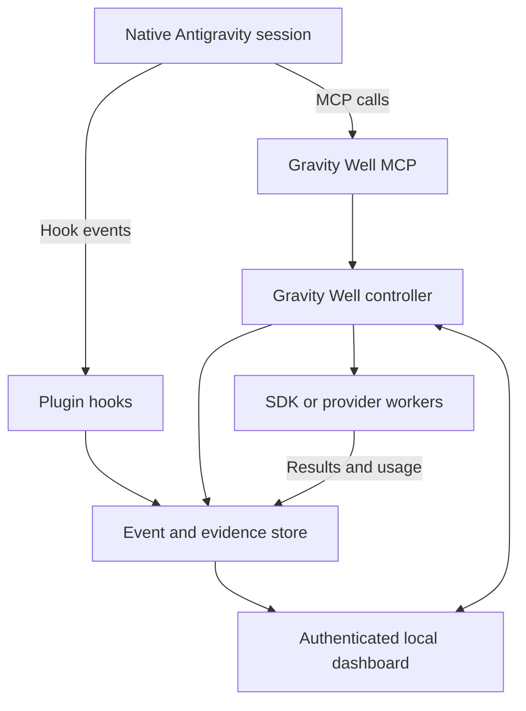

# Gravity Well Harness: Antigravity Public API Integration Repair

**Review date:** 7 November 2026, UTC  
**Repository baseline:** [`c619f9dd4212b892c372f9491a2ce7b2e8be1c8a`](https://github.com/BaiTian6641/Gravity-Well-Harness/tree/c619f9dd4212b892c372f9491a2ce7b2e8be1c8a)  
**Status:** Proposed migration and acceptance plan; these repairs have not been implemented.  
**Companions:** [Repository review and roadmap](01_Gravity_Well_Review_and_Roadmap.md), [default operating contract](03_gravity_well_default.md), and [Argon context resilience](04_Argon_Context_Resilience.md).

## 1. Integration decision

Build two cooperating systems: a native Antigravity plugin for knowledge and workflow augmentation, and a Gravity Well runtime that owns its workers, evidence, provider connections, and dashboard. Native observations must remain distinguishable from workers the harness can actually control.

**The default programmable worker backend should be the public Python SDK with separately authorized Google AI Studio/Gemini API or Vertex credentials, or an independent provider's public API.** Google's current FAQ permits direct scripting/CI with `agy -p`, but says consumer-plan wrapping inside third-party coding agents or applications is unsupported. Gravity Well must not obtain its worker backend by reusing an Antigravity consumer login, extracting credentials, proxying the consumer transport, or disguising that wrapping as an ACP integration. [Official FAQ](https://antigravity.google/docs/faq/)

The native plugin can still provide substantial value: project RAG, durable task packets, provenance, verification reminders, and observations from documented hooks. An optional App sidecar can use its documented conversation-creation and messaging commands. Full scheduling, cancellation, evaluation, and model routing belong to Gravity Well-owned workers.

A publicly documented interface is the eligibility threshold, not a promise of permanent stability. Each supported integration needs a pinned version, schema fixtures, an actual conformance run, and an explicit disabled state when its prerequisites are absent.

## 2. Public capability matrix

Product names identify different integration surfaces; the standalone IDE, App, CLI, Python SDK, and Google's extensions for other editors are not interchangeable.

| Surface | Verified public contract and source | Gravity Well use | Boundary |
|---|---|---|---|
| Native MCP: App, CLI, IDE | Local stdio and remote Streamable HTTP configuration; [MCP guide](https://antigravity.google/docs/mcp/) | Expose RAG, task state, evidence, and explicitly authorized harness operations | Antigravity calls our server. MCP does not grant control of native sessions. |
| Native hooks: App, CLI, IDE | JSON command hooks and six lifecycle events; [Hooks](https://antigravity.google/docs/hooks/) | Context refresh, tool observations, correlation, completion reminders | Hook payloads are partial observations, not a general session-control API. |
| Rules and skills | Persistent cumulative instructions and reusable workflows; [Rules](https://antigravity.google/docs/rules/), [Skills](https://antigravity.google/docs/skills/) | Concise invariants plus task-specific procedures | Instructions do not replace executable authorization or verification. |
| Native plugins | Manifest and bundled MCP/hooks/rules/skills/agents; [Build plugins](https://antigravity.google/docs/build-plugins/) | Distribute the supported native augmentation | A plugin manifest is distinct from a VS Code extension manifest. |
| Native subagents | Guide explicitly badges **App and CLI**; parent delegation, isolated context, worktree options, messaging; [Custom subagents](https://antigravity.google/docs/subagents/) | Supply role definitions and observe supported native delegation | Do not assume standalone IDE parity. Agent-visible tools are not externally callable RPC methods. |
| App sidecars | Host-managed background process and injected `agentapi`; [Sidecars](https://antigravity.google/docs/sidecars/) | Optional App initiation/message bridge | App only. No general list/read/cancel/model-change capability established by this guide. |
| App custom UI | v2.22.0, **8 October 2026**, announces installed-plugin side-pane interfaces; [Changelog](https://antigravity.google/docs/changelog/) | Future optional dashboard presentation adapter | The feature exists; a sufficient public authoring/runtime contract was not verified in this review. |
| Python SDK | `google-antigravity`, `Agent`, `LocalAgentConfig`, own-session execution; [SDK overview](https://antigravity.google/docs/sdk/overview) | Primary programmable worker backend using API/Vertex credentials | Creates/owns SDK sessions; does not attach to existing GUI conversations. |
| SDK local models | LiteRT and `LocalOpenAIAgentConfig`; [Local models](https://antigravity.google/docs/sdk/local-models/) | Optional tested local-model workers | Local compatibility does not establish arbitrary cloud BYOK support in the native model picker. |
| CLI headless | Direct scripting/CI, structured output; [Headless](https://antigravity.google/docs/cli/headless/), [FAQ](https://antigravity.google/docs/faq/) | User-run diagnostics or a separately supported usage arrangement | Disabled as the default embedded consumer worker. |
| ACP | Editor-launched `agy acp`, JSON-RPC over stdio; [ACP](https://antigravity.google/docs/cli/acp/) | A deliberately supported editor-client integration | No inferred right to repurpose consumer sessions as a third-party swarm service. |
| IDE extension presentation | Google's editor integration guides; [IDE extensions](https://antigravity.google/docs/ide/extensions/) | Optional view through a separately verified public editor extension API | An extension setting cannot register a native model backend or control hidden agent internals. |

Where a capability is unverified, display the reason and supported alternatives. Never silently substitute private RPCs or simulated results.

## 3. Target architecture and ownership

The following is the proposed Gravity Well architecture, not a vendor API diagram:



The controller owns workspace authorization, job admission, budgets, immutable RAG snapshots, worker processes, and verification. The event store owns the recorded history; the dashboard is a projection. A native session contributes only observations that an authorized adapter actually received.

Keep the existing UI's useful graph, RAG explorer, and settings concepts. Replace their data and control paths before adding more visualization. A model selector in Gravity Well chooses a backend for a **new harness worker**; the native session's observed model is a separate read-only field.

## 4. Current-file migration map

All code references below are pinned to the reviewed commit.

| Current implementation | Required repair | Completion evidence |
|---|---|---|
| [`setup.mjs:61–81`][R1a] and [139–212][R1b] uses `JetboxWriteState`, sidecar discovery, process termination, and management RPCs | Replace with documented plugin installation/configuration and optional public sidecar configuration | No hidden RPC/process discovery; installation stages report their actual result |
| [`server.mjs:14–22`][R2a] and [294–298][R2b] depends on kit RPC/workspace helpers | Remove `antigravity-sidecar-kit`; separate the portable controller/dashboard from the App adapter | Dashboard starts without native host processes or native credentials |
| [`server.mjs:384–444`][R3a] and [528–560][R3b] infers workspace and scans private brain directories | Bind registered workspace/session IDs; ingest explicit hooks/worker events | Two projects cannot exchange observations through fallback selection |
| [`server.mjs:1970–2007`][R4a] and [2290–2367][R4b] derives usage and activity from defaults/time | Replace with evidence-backed projections; keep demonstrations explicitly separate | No events means no fabricated activity, agents, usage, or success |
| [`post-tool-use.mjs:118–198`][R5] reads singular subagent arguments and infers completion | Decode documented batches and stable IDs; remove time-based completion and role matching | Same-role children remain distinct; long-running work stays running |
| [`server.mjs:117–183`][R6] implements Recall/Finish as JSON edits | Route supported actions to an owned executor; label annotation-only actions honestly | Dispatch and execution acknowledgement are separately visible |
| [`server.mjs:186–292`][R7] and [3012–3094][R12] silently falls back to unauthenticated HTTP | Make local dashboard mode explicit and enforce authentication, methods, limits, and roots | Unauthorized requests cause no state change or provider request |
| [`src/model-hub.mjs:910–978`][R8] conflates observed native models with harness routing and guesses transcript paths | Separate native observations, provider routing, and context accounting | Observing a native model cannot overwrite an independently selected worker backend |
| [`harness2_antigravity_executor.py:247–353`][R9] mixes SDK output with fixed scores and simulated fallback | Build an actual SDK driver, measured usage, and independent evaluation | Required credential/API failure is failure; verification requires stored artifact/test evidence |
| [`vscode-extension/package.json`][R10] contributes settings without a delivery path | Package a verified optional extension or use dashboard settings only | Published artifact installs and settings alter actual harness behavior |
| [`sidecar package.json:7–19`][R11] omits imported modules and depends on the kit | Build one self-contained artifact from canonical source | Clean unpack/install/start succeeds without source-tree dependencies |

`npm pack --dry-run` confirmed that `secret-vault.mjs` and `model-hub.mjs` are absent from the current sidecar package although the server imports them. Existing passing tests do not exercise that distribution boundary. [Package][R11], [startup imports][R13]

## 5. Repair the native plugin first

### 5.1 Preserve valid customization mechanisms

Keep `plugin/harness-ide` as the native package. Its existing named hook groups, flat `SessionStart`/`PreInvocation` handlers, nested tool handlers, and `rules/AGENTS.md` layout are legitimate mechanisms. The official plugin guide explicitly supports always-on `rules/AGENTS.md` without frontmatter; the defect is not the existence of that file. [Build plugins](https://antigravity.google/docs/build-plugins/)

Use [the default operating contract](03_gravity_well_default.md) as a maintained instruction source. Preserve existing user instructions when installing it. Keep invariant text short; move detailed recovery, review, and experiment procedures into skills. Do not append an entire knowledge corpus to every turn.

### 5.2 Make MCP paths and permissions explicit

For a bundled server, use the documented plugin-root substitution. This example retains the current entry-point name; the runtime still needs the repairs described here:

```json
{
  "mcpServers": {
    "harness_ide_rag_mcp": {
      "command": "node",
      "args": ["${PLUGIN_ROOT}/scripts/mcp-entry.mjs"]
    }
  }
}
```

For workspace configuration, use an installer-resolved absolute executable/script path in `.agents/mcp_config.json`. Prefer stdio initially. If a remote service becomes necessary, use the canonical `serverUrl` Streamable HTTP configuration; the guide explicitly excludes legacy HTTP+SSE/`httpUrl` in its CLI section. Verify other native surfaces separately rather than inferring identical transport support. [MCP configuration](https://antigravity.google/docs/mcp/)

Separate read-only knowledge tools from mutation and worker-submission tools. A tool call carries a controller-issued workspace identity, not authority derived from an arbitrary `workspaceRoot` string. A submitted task returns a durable job identifier; a long evaluation should not hold a fragile synchronous tool call open indefinitely.

### 5.3 Correct hook decoding and bounded context injection

Native hook input uses camelCase fields such as `conversationId`, `workspacePaths`, `modelName`, and `toolCall`. For `invoke_subagent`, decode **`toolCall.args.Subagents`**, an array of specifications containing `Prompt`, `Role`, `TypeName`, and optional `Workspace`. `PostToolUse` supplies invocation/error metadata, not a guaranteed full tool result. [Hooks contract](https://antigravity.google/docs/hooks/)

Use a shared, versioned decoder with fixtures for each supported surface. Validate types and generate a Gravity Well ingestion ID in the hook emitter, retaining it across delivery retries. Preserve a native call ID only when the documented payload supplies one. Emit one spawn observation per child; identical tool arguments are not sufficient grounds for deduplication. If the actual child ID is not yet known, keep the relationship provisional; do not invent an authoritative conversation ID or merge workers by role.

A compact hook registration can use the documented structure:

```json
{
  "gravity-well-context": {
    "enabled": true,
    "PreInvocation": [
      {
        "type": "command",
        "command": "node ./scripts/hooks/pre-invocation.mjs",
        "timeout": 10
      }
    ]
  }
}
```

Plugin hook commands run relative to the plugin root. Keep machine JSON on stdout and diagnostics on stderr. A context response can use:

```json
{
  "injectSteps": [
    {"ephemeralMessage": "Task GW-17: requirement R3 remains unverified. Re-read the referenced contract before editing."}
  ]
}
```

The packet content is a Gravity Well design: objective, unresolved requirement IDs, relevant source references/hashes, snapshot ID, and next verification. Apply a measured size budget, redact secrets, and treat retrieved text as data. Persist its content/hash so restart or compaction can rebuild it.

Hooks that exit nonzero fail open. Consequently, a `Stop` check is useful feedback but cannot be the sole authorization, snapshot, or success gate. Enforce those gates in the controller, RAG store, and evaluator. [Plugin hook behavior](https://antigravity.google/docs/build-plugins/)

Record a supplied `transcriptPath` as a session reference. Parsing it is optional and requires a verified record contract for the pinned host; the baseline needs no private-log parser. Never enumerate guessed brain directories or select another conversation when the requested one is absent.

## 6. Implement Gravity Well-owned workers with the public SDK

Use a dedicated Python environment with a locked `google-antigravity` release. The SDK documents `Agent`, `LocalAgentConfig`, API-key authentication, and Vertex configuration using `vertex=True`, `project`, and `location`. Google Cloud credentials and Gemini API keys belong to the selected worker account, independently of the user's native Antigravity login. [SDK overview](https://antigravity.google/docs/sdk/overview)

The following is a minimal API-shape example, not a production worker or a completed repair:

```python
from google.antigravity import Agent, LocalAgentConfig

async def execute(prompt: str):
    async with Agent(LocalAgentConfig()) as agent:
        response = await agent.chat(prompt)
        result_text = await response.text()
        return result_text, response.usage_metadata
```

The trusted launcher supplies `GEMINI_API_KEY` or the configured Vertex identity. Production construction must additionally bind the authorized workspace, policies, bounded tools, persistence location, and context packet. The current adapter's `system_instruction` spelling differs from the documented `system_instructions`; replace handwritten assumptions with contract tests. [Current adapter][R9]

Prefer documented templated instructions so the SDK retains its runtime scaffolding. Configure tool policies explicitly; a natural-language “do not write outside this directory” rule is insufficient. SDK policy hooks are a separate API from native JSON command hooks. [SDK personas](https://antigravity.google/docs/sdk/personas/), [SDK policies](https://antigravity.google/docs/sdk/policies/)

Run each probe in an independently prepared worktree/process with its assigned snapshot and budget. Store SDK session state under a harness-owned run directory. Use response usage when present; absence remains unknown. Attach the actual model/provider, configuration version, timestamps, and artifacts to results. SDK subagents can be enabled or statically configured through documented capabilities, but nested delegation needs an explicit concurrency/budget limit. [SDK lifecycle](https://antigravity.google/docs/sdk/lifecycle/), [SDK subagents](https://antigravity.google/docs/sdk/subagents/)

For third-party cloud models, implement provider-specific adapters against each provider's public API with separately supplied credentials. Validate streaming, tool calling, reasoning controls, cancellation, and usage individually. Do not assume OpenAI-shaped JSON proves full behavioral compatibility. Local compatible servers can use the documented SDK local-model path. Provider selection never rewrites the native model menu.

Harness² integration also requires a real upstream extension: the pinned upstream channel/install-mode types and proposer dispatch need to accept the SDK path, alongside the substrate and benchmark adapters. Follow [document 01](01_Gravity_Well_Review_and_Roadmap.md); adding this worker class alone does not establish Harness² compatibility.

## 7. Optional App sidecar: narrow capabilities only

Replace the current UI/RPC manifest with a documented process manifest if an App background adapter remains useful:

```json
{
  "command": "node",
  "args": ["dist/app-sidecar.mjs"],
  "display_name": "Gravity Well",
  "description": "Run the optional Gravity Well App adapter",
  "restart_policy": "on-failure"
}
```

`dist/app-sidecar.mjs` is a proposed artifact that must be bundled inside the sidecar directory: that directory is the process working directory. It is not resolved from the plugin root. For a plugin sidecar named `app-bridge`, merge the following into `~/.gemini/config/config.json`, substituting the actual project ID:

```json
{
  "sidecars": {
    "harness-ide/app-bridge": {
      "enabled": true,
      "projectId": "<project-id>"
    }
  }
}
```

`projectId` is required for conversation creation. Invoke the injected executable with argument arrays:

```text
agentapi new-conversation <prompt>
agentapi send-message <conversation_id> <prompt>
```

Do not invent JSON output, cancellation verbs, list endpoints, or native model mutation. Test command behavior on the pinned App release and preserve the distinction between command acceptance and observed task execution. [Sidecars](https://antigravity.google/docs/sidecars/)

Keep this adapter optional. The authenticated dashboard and owned workers must function without it. Remove `has_web_ui`, auxiliary-pane enums, launcher retry URLs, and wildcard `agent_permissions` from the supported manifest unless a sufficient official contract is subsequently verified. The announced side-pane UI can be reconsidered after that contract and a conformance test exist; its announcement alone does not validate the current kit implementation.

## 8. Replace display state with an evidence-based run model

### Identity and persistence

Introduce an append-only event ledger or transactional event table. Each record needs a schema version, event ID, observed timestamp, workspace ID, task/run/attempt ID, parent run ID when applicable, source adapter/version, and payload provenance. Native conversation IDs and provider request IDs are references, not interchangeable primary keys.

Ingestion must be idempotent. Concurrent hook writers submit events to one transactional writer instead of replacing a shared JSON file. A crash recovers committed records; a replay reconstructs the same graph. Role names and labels are presentation fields. Canonical workspace identities must preserve case where the filesystem does.

### State and evidence

Use a Gravity Well-owned state model:

| State | Required evidence |
|---|---|
| `queued` / `starting` | Admitted job / launch attempted |
| `running` / `waiting` | Executor acknowledgement / explicit waiting event |
| `verifying` | Executor finished; independent acceptance checks remain |
| `succeeded` | Required checks passed with preserved evidence |
| `failed` / `blocked` | Recorded failure or unmet permission/dependency |
| `cancel_requested` | Cancellation submitted, not yet confirmed |
| `cancelled` | Owned execution stopped and cleanup outcome recorded |
| `unknown` / `stale` | Connection/heartbeat lost; result not established |

Preserve native state separately rather than pretending native idle/termination directly means verified success. Elapsed time and parent tool counts never prove completion. Replace Recall with Resume/Send only where an adapter supports the operation; retain “show hidden node” solely as a view action.

### Messages and cancellation

An outgoing message records sender, exact recipient run, message ID, context references, and delivery status. Distinguish persisted, dispatched, accepted, and consumed. A stored Markdown message or successful HTTP response is not proof that a model received the content. Unknown recipients fail explicitly; there is no fallback to the last worker.

For owned workers, deliver queued messages at a supported turn boundary and record incorporation in the next packet. Resume creates a new attempt or uses verified SDK persistence; it never simulates running state. Cancellation calls a documented adapter capability where available, otherwise stops only the child process tree the controller launched. Preserve evidence and wait for observed termination. No killing a process discovered from a native host port.

Native App `send-message` has a narrower acknowledgement contract. Show the strongest observation actually available. If native cancellation is unavailable, disable the control and direct the user to the host's own supported UI.

## 9. Make the dashboard truthful and secure

Replace fake active nodes and synthetic token/DNA charts with three explicit value classes: **observed**, **estimated**, and **unavailable**. Every estimate records its method and input scope. Prompt-packet token estimates cannot stand in for the native session's hidden context, cache, thinking usage, or billing. Display observed native `modelName` without silently substituting a catalog guess.

Costs require the actual provider/model, usage category, and dated price configuration; show estimated cost separately from provider billing. Missing cache or latency breakdowns stay unavailable. Idle wall time may update a duration, but cannot create tool calls, tokens, compactions, successful tests, or agents. This directly replaces the current time-driven analytics. [Analytics defaults][R4a], [wall-clock metrics][R4b]

Use the existing frontend against one explicit authenticated local service. Require a random session credential, allowed Host/Origin checks, method-aware routing, JSON validation, body limits, timeouts, and rate limits. GET must be read-only. Provider invocation, installation, knowledge mutation, and job control need separate capabilities. Keep tokens out of logs, URLs, retrieved documents, and frontend bundles. The existing fallback's loopback binding alone does not supply these checks. [Current fallback][R7]

Register roots through a trusted onboarding flow and bind requests to their IDs. Validate real paths, directory types, collection containment, symlinks, and artifact paths before access. File authorization applies to MCP, hooks, HTTP, workers, and indexing. A RAG result cannot expand its own permissions or authorize an external message.

## 10. Installation, packaging, and configuration repair

Build plugin, controller, worker adapter, and optional presentation packages from canonical source. Remove installer-time source copying as the synchronization mechanism. Include all imported runtime modules, lock dependencies, and test the packed artifact outside the checkout. Keep native configuration separate from harness provider settings and secrets.

Replace automatic raw activation with reviewable stages: inspect host/version, validate package, present selected workspace/scope, install through documented mechanisms, enable selected components, and verify health. The official plugin workflow includes:

```bash
agy plugin validate --strict ./plugin/harness-ide
agy plugin install ./plugin/harness-ide
agy plugin list --json
```

These are direct plugin-management operations, not consumer worker wrapping. Their result still needs inspection. [Plugin validation and installation](https://antigravity.google/docs/build-plugins/)

Add dry-run, installation ownership records, backups, atomic configuration merges, and rollback. Reinstallation must preserve telemetry, task state, unrelated settings, and credentials. Report copied, registered, enabled, and healthy independently; exit nonzero for failed required stages. Uninstall removes only owned artifacts and offers to preserve run evidence.

Default credential storage should use an OS credential facility or an independently supplied process environment. Keep provider identities per workspace/profile, redact diagnostics, and permit export/removal. Do not derive keys from native account storage. A UI settings extension is optional and must have a real package/install path before claiming native settings support. [Activation][R1b], [telemetry replacement][R14], [settings manifest][R10]

## 11. Staged pull requests and acceptance gates

| PR | Deliverable | Required gate before proceeding |
|---|---|---|
| **I-1: Remove unsupported coupling** | Delete kit/RPC/private-log paths; introduce capability reporting and explicitly separate demo output | Source scan rejects `JetboxWriteState`, Cascade/ManageSidecar calls, CSRF extraction, native process discovery, and brain enumeration in shipped runtime code |
| **I-2: Native plugin conformance** | Correct MCP paths, batched hook decoder, bounded packets, default rules/skills | Strict plugin validation; official-schema fixtures; actual App/IDE hook smoke test for each claimed surface; three same-role children remain distinct where native delegation is supported |
| **I-3: Secure controller and ledger** | Authorized roots, transactional events, authenticated dashboard API | Wrong token/origin/method, oversized payload, traversal, and symlink tests cause no mutation; concurrent writers/restart lose no committed events |
| **I-4: SDK worker execution** | API/Vertex credentials, isolated workspaces, policies, measured outputs, resume/cancellation | One genuine task produces an artifact and stored check result; missing required provider credentials fail; cancellation stops owned work; no native account access |
| **I-5: Genuine swarm controls** | Job dependencies, budget/concurrency limits, message acknowledgement, deterministic graph projection | Parallel same-role workers, restart, delayed completion, failed message, and cancelled task all display correctly; a ten-minute worker is never auto-completed by a timer |
| **I-6: Evaluation integration** | Upstream Harness² channel/substrate/benchmark work plus immutable snapshots and independent evaluation | Two real candidates receive identical frozen evidence. Selection uses permitted trajectory/artifact evidence; held-out judging follows committed selection; production promotion requires qualifying receipts. Candidates cannot modify their grader or promote themselves |
| **I-7: Distribution and optional App bridge** | Clean packages, transactional installer, narrow `agentapi` adapter | Fresh install/upgrade/uninstall on supported OS/host versions; packed startup succeeds; native unsupported controls remain disabled |

App side-pane or editor-extension UI is a later presentation PR with its own public-contract proof. It must not delay a functioning standalone dashboard or become a reason to reintroduce private interfaces.

## 12. Compatibility and release policy

Maintain a compatibility manifest recording host surface/version, OS, SDK package/runtime version, adapter version, provider/model identity, public documentation URLs, fixture revision, and last successful conformance run. Pin exact releases for shipping; test upgrades in CI before widening the supported range. Unknown versions enter a clearly limited mode rather than trying a hidden fallback.

A release is ready when a user can install it, configure a supported worker backend, submit genuine isolated workers, see their actual state, convey bounded context, inspect evidence, and recover from cancellation/restart without false success. Native augmentation must also work when no managed worker is running. Historical “Completed” stages should retain their dates while distinguishing prototype checks from these verified integration gates.

## Evidence and limits of this review

The code findings refer to the pinned commit above. Isolated reproductions verified that empty analytics inputs produce invented activity and that the extracted HTTP dispatcher accepts an unauthenticated wrong-method request. Package inspection confirmed the missing runtime files. These checks establish concrete repair targets; they do not validate a native Antigravity installation.

No native App/IDE conformance run or paid provider execution was performed in this review. The current local test results therefore cannot be promoted into a supported-host compatibility claim. The first shipping compatibility row must include a genuine host/SDK run and its stored evidence. Official documentation was checked on the review date; later releases require renewed contract testing.

[R1a]: https://github.com/BaiTian6641/Gravity-Well-Harness/blob/c619f9dd4212b892c372f9491a2ce7b2e8be1c8a/setup.mjs#L61-L81
[R1b]: https://github.com/BaiTian6641/Gravity-Well-Harness/blob/c619f9dd4212b892c372f9491a2ce7b2e8be1c8a/setup.mjs#L139-L212
[R2a]: https://github.com/BaiTian6641/Gravity-Well-Harness/blob/c619f9dd4212b892c372f9491a2ce7b2e8be1c8a/sidecars/harness-ide-monitor/server.mjs#L14-L22
[R2b]: https://github.com/BaiTian6641/Gravity-Well-Harness/blob/c619f9dd4212b892c372f9491a2ce7b2e8be1c8a/sidecars/harness-ide-monitor/server.mjs#L294-L298
[R3a]: https://github.com/BaiTian6641/Gravity-Well-Harness/blob/c619f9dd4212b892c372f9491a2ce7b2e8be1c8a/sidecars/harness-ide-monitor/server.mjs#L384-L444
[R3b]: https://github.com/BaiTian6641/Gravity-Well-Harness/blob/c619f9dd4212b892c372f9491a2ce7b2e8be1c8a/sidecars/harness-ide-monitor/server.mjs#L528-L560
[R4a]: https://github.com/BaiTian6641/Gravity-Well-Harness/blob/c619f9dd4212b892c372f9491a2ce7b2e8be1c8a/sidecars/harness-ide-monitor/server.mjs#L1970-L2007
[R4b]: https://github.com/BaiTian6641/Gravity-Well-Harness/blob/c619f9dd4212b892c372f9491a2ce7b2e8be1c8a/sidecars/harness-ide-monitor/server.mjs#L2290-L2367
[R5]: https://github.com/BaiTian6641/Gravity-Well-Harness/blob/c619f9dd4212b892c372f9491a2ce7b2e8be1c8a/plugin/harness-ide/scripts/hooks/post-tool-use.mjs#L118-L198
[R6]: https://github.com/BaiTian6641/Gravity-Well-Harness/blob/c619f9dd4212b892c372f9491a2ce7b2e8be1c8a/sidecars/harness-ide-monitor/server.mjs#L117-L183
[R7]: https://github.com/BaiTian6641/Gravity-Well-Harness/blob/c619f9dd4212b892c372f9491a2ce7b2e8be1c8a/sidecars/harness-ide-monitor/server.mjs#L186-L292
[R8]: https://github.com/BaiTian6641/Gravity-Well-Harness/blob/c619f9dd4212b892c372f9491a2ce7b2e8be1c8a/src/model-hub.mjs#L910-L978
[R9]: https://github.com/BaiTian6641/Gravity-Well-Harness/blob/c619f9dd4212b892c372f9491a2ce7b2e8be1c8a/adapters/harness2_antigravity_executor.py#L247-L353
[R10]: https://github.com/BaiTian6641/Gravity-Well-Harness/blob/c619f9dd4212b892c372f9491a2ce7b2e8be1c8a/vscode-extension/package.json#L1-L117
[R11]: https://github.com/BaiTian6641/Gravity-Well-Harness/blob/c619f9dd4212b892c372f9491a2ce7b2e8be1c8a/sidecars/harness-ide-monitor/package.json#L7-L19

[R12]: https://github.com/BaiTian6641/Gravity-Well-Harness/blob/c619f9dd4212b892c372f9491a2ce7b2e8be1c8a/sidecars/harness-ide-monitor/server.mjs#L3012-L3094
[R13]: https://github.com/BaiTian6641/Gravity-Well-Harness/blob/c619f9dd4212b892c372f9491a2ce7b2e8be1c8a/sidecars/harness-ide-monitor/server.mjs#L23-L42
[R14]: https://github.com/BaiTian6641/Gravity-Well-Harness/blob/c619f9dd4212b892c372f9491a2ce7b2e8be1c8a/setup.mjs#L215-L257
