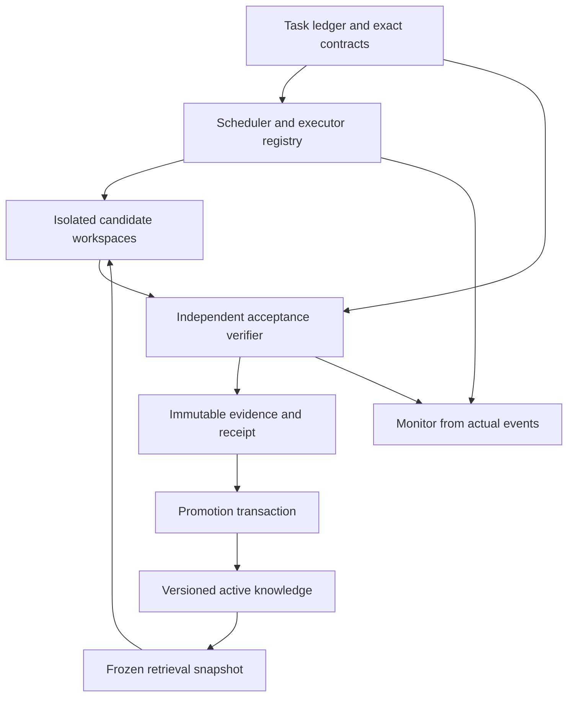

# Gravity Well Harness — detailed implementation and public integration plan

**Planning baseline:** `c98e2822d1b18bcc3b9b36ba1b27f17499005fc2`  
**Date:** 8 November 2026, Asia/Shanghai  
**Companion review:** `07_Gravity_Well_Review_c98e282.md`  
**Goal:** a dependable Antigravity enhancement with real agent orchestration, verified self-improvement, durable context, built-in retrieval, and optional third-party executors.

This is a proposed implementation plan, not a statement that the interfaces or modules proposed below already exist. It follows the fourth review's successful 18-test baseline and its remaining integration failures.

## 1. Define the next release by observable behavior

The next release should support a small complete workflow:

1. The installed plugin submits a task with explicit requirements and acceptance checks.
2. The harness selects a registered executor and verifier.
3. A candidate receives a complete source snapshot in its own workspace.
4. The executor performs the requested work and reports artifacts, events, and usage.
5. A verifier executes the relevant acceptance checks against those artifacts.
6. A failed or simulated attempt remains in history without becoming active knowledge.
7. A passing attempt can produce a versioned lesson with a valid receipt.
8. The monitor displays actual execution and acknowledged control operations.
9. A restart or later user correction preserves the current requirement set.
10. Repeating the task creates a new attempt without invalidating the previous valid lesson.

This directly addresses the observed gaps: the MCP loop currently cannot select its callback executors, Python can sign unchecked success, a repeated task breaks lesson binding, and monitor controls change status without an executor. [MCP route][C03] [Python bridge][C24] [Lesson recording][C09] [Monitor controls][C38]

### Release invariants

| Invariant | Enforcement owner |
|---|---|
| Every production run names a real executor and task revision | Scheduler |
| Every candidate sees a reproducible input tree and frozen retrieval version | Workspace manager and retrieval service |
| Delivered, evaluated, verified, and promoted are distinct outcomes | Shared result schema |
| Only an executed authorized verifier establishes verified success | Verification service |
| Simulation provenance survives every fallback, adapter, and aggregate | Executor/result contract |
| Receipts and evaluated lesson revisions are immutable | Evidence store |
| A new failed attempt cannot destroy prior valid knowledge | Promotion transaction |
| Every measured total accounts for all executed phases or declares incompleteness | Usage collector |
| Controls change execution state only through acknowledged executor events | Executor registry and event reducer |
| A material correction invalidates stale recovery and evidence | Task/requirement service |

Treat these as product requirements. A passing unit test for an individual helper is supplementary evidence.

## 2. Establish one runtime contract

### 2.1 Proposed ownership



The monitor reads events and submits control requests. It does not establish verification. A model worker supplies artifacts and observations. It does not authenticate its own acceptance result.

### 2.2 Proposed data contracts

These are Gravity Well-owned contracts, not new Antigravity APIs.

**Run request**

```json
{
  "schema_version": 1,
  "task_id": "scheduler-task",
  "task_revision": 4,
  "attempt_id": "unique-attempt-id",
  "candidate_id": "candidate-1",
  "executor_id": "registered-command-or-sdk-executor",
  "verifier_id": "registered-scheduler-acceptance-checks",
  "workspace_id": "authorized-project",
  "source_tree_digest": "immutable-input-identity",
  "snapshot_id": "frozen-retrieval-identity",
  "requirement_ids": ["REQ-CREATE", "REQ-CANCEL"],
  "execution_mode": "production",
  "budget_profile": "bounded-coding-task"
}
```

**Result sections**

| Section | Required meaning |
|---|---|
| `execution` | Started/finished/failed/cancelled state, owned worker/session ID, timestamps, exit/transport result, provenance |
| `artifacts` | Exact paths, content hashes, input identity, output identity, artifact manifest |
| `evaluation` | Verifier ID/version, executed checks, exit status, verdict, raw-log references |
| `usage` | Per-phase measurements, quality, source, completeness, unknown components |
| `learning` | Candidate lesson ID/revision, receipt ID, promotion status and reason |
| `recovery` | Current task/ledger revision, delivered packet identity, acknowledgment state |

A result can report execution succeeded while evaluation failed or learning was not promoted. Avoid one ambiguous `ok` field governing all downstream effects.

Normalize all public input names at the transport boundary. Publish one canonical snake_case schema; internal types may use another style only through tested conversion. Generate advertised MCP schemas, argument validation, and adapter mapping from that contract. The current mismatch between advertised recovery names and camelCase checks is a concrete reason for doing this. [Recovery][C28] [MCP schemas][C31]

### 2.3 Suggested module boundaries

Refactor incrementally from the existing implementation:

| Responsibility | Suggested boundary | Current integration targets |
|---|---|---|
| Validated run/task objects | `src/core/contracts` | MCP, monitor, model hub, Python bridge |
| Executor registration and dispatch | `src/executors` | Model hub and Python adapter |
| Workspace materialization | `src/runtime/workspaces` | JavaScript candidate roots and Python staging |
| Verifier execution and result validation | `src/verification` | RAG receipt issuer, context evidence, Python score |
| Immutable attempts/receipts/lessons | `src/evidence` | Current RAG recording/promotion |
| Worker events and controls | `src/runtime/events` | Hooks, monitor, lifecycle stores |
| Task state and recovery | Existing context manager behind typed interfaces | Hooks, MCP, every executor |
| Retrieval/index/snapshot | Existing RAG engine | MCP resources and executor retrieval |

Do not begin with a wholesale rewrite. Extract the shared contracts and route one real execution path through them, retaining the now-correct regressions.

## 3. Ordered work packages

### WP1 — Make verification authoritative in every runtime

**Priority:** first, before relying on automatic promotion.  
**Files:** Python executor/scoring/receipt bridge, `rag-engine.mjs`, `context-resilience.mjs`, MCP validators.

**Implementation**

1. Introduce a verifier registry whose entries define the executable check, allowed inputs, expected result schema, and version.
2. Produce evaluation results from the verifier runner, not from arbitrary worker-provided JSON or an artifact's existence.
3. Route Python and JavaScript through the same result validation and receipt rules.
4. Carry `execution_mode` and `synthetic` from each actual probe route. Never infer them from credential presence.
5. Require task/attempt/candidate identity and an artifact manifest for a successful code-change evaluation.
6. Have the context ledger call the actual receipt verifier and match requirement/source revisions.
7. Revalidate evidence whenever a recorded source, output, verifier, requirement, or dependency changes.
8. Keep failed checks and logs available for diagnosis.

**Do not count as verification:** exit zero alone, a new file alone, a passing flag written by the worker, signature length, a model's evaluation of itself, or a UI completion action. The current Python and context paths demonstrate these distinctions. [Python execution][C20] [Scoring][C21] [Context evidence][C25]

**Acceptance**

- A TODO-only scheduler output fails the create/cancel behavior checks.
- A no-op retry cannot reuse an old file as new verified work.
- A correctly produced artifact passes the same verifier.
- A simulated SDK fallback stays synthetic and cannot enter active knowledge.
- Modified or unauthenticated evidence fails through actual packaged MCP.
- A changed consumer reopens its requirement even without a registered contract.
- Missing contract source files remain unresolved.

### WP2 — Connect the distributed interface to real upstream and SDK execution

**Depends on:** the run/result contract; WP1 for verified completion.  
**Files:** Python adapter, MCP loop handler, executor registry, packaging/tests.

**Implementation**

1. Pin and import Google's real Harness² types and `resolve_prompts`. Remove shadow types from the compatibility path.
2. Implement the selected upstream installation mode, source-tree fingerprinting, `file:<relative>` integration entries, and benchmark-owned launch semantics.
3. Preserve the new candidate `run.py` launcher as a concrete command executor.
4. Register a command executor and a verifier with server-controlled capabilities.
5. Add serializable `executor_id` and `verifier_id` selection to the MCP run request.
6. Make production loop mode strict by default. Explicit demo is a separate mode with synthetic results.
7. Configure an SDK-owned worker using actual public fields, as detailed in section 4.
8. Validate effective configuration before contacting the provider.
9. Keep text-only provider requests distinct from coding executors with tools/workspaces.

The current local launcher is a useful base. The exact upstream `Install` and resolver failures should be repaired rather than hidden behind another similarly named helper. [Adapter types][C18] [Launcher][C19] [Actual upstream specification][U01] [Substrate][U02]

**Acceptance**

- An offline contract test imports the real pinned upstream package and uses its real objects.
- Materialization produces the expected integration files and executable tree.
- A packed plugin invoked outside the source checkout executes one fixture task through MCP.
- An absent executor returns unavailable, with no verified result or lesson.
- The actual SDK configuration contains the intended workspace, model, and budget.
- A supported-host/provider smoke task confirms effective runtime behavior separately from mocked tests.

### WP3 — Run candidates against complete inputs and make scheduling/accounting truthful

**Depends on:** WP2 execution registry; WP1 verifier.  
**Files:** JavaScript loop, Python loop, workspace manager, usage collector.

**Implementation**

1. Materialize a complete immutable input tree per candidate, preferably with isolated Git worktrees or equivalent verified copies.
2. Record a policy for uncommitted input changes. Include them in the input identity or reject an ambiguous comparison.
3. Define dependencies shared read-only and outputs owned by each attempt.
4. Ensure tools actually run in the candidate root; avoid closures that write into a shared project root.
5. In sequential mode, execute and evaluate before dispatching the next candidate.
6. In parallel mode, launch only within a concurrency budget and account for work already in flight when stopping.
7. Capture immutable artifact manifests and per-candidate results before winner selection.
8. Apply the winner as a separate integration operation, followed by integration verification.
9. Preserve usage from failed and unselected candidates.
10. Record measurement completeness explicitly.

The current candidate directories preserve required outputs, but do not contain a complete reproducible project input. The current early-stop logic also reports executed work as skipped. [Candidate capture/dispatch][C11] [Evaluation][C12] [Accounting][C13]

**Usage model**

```json
{
  "observed_subtotal": 100,
  "complete": false,
  "total": null,
  "unknown_components": ["candidate-2.execution"],
  "quality": "partial_observation"
}
```

Use this shape when one candidate reports 100 and another is unknown. Zero is reserved for a measured zero. Separate executor and verifier usage so one cannot silently replace the other.

**Acceptance**

- Two candidates read identical complete inputs and cannot alter each other's workspace.
- After a first-candidate stopping verdict, the second sequential executor is never called.
- Every already-started parallel attempt remains in cost and usage accounting.
- The existing three-candidate fixture reports all 600 supplied units if all three execute.
- A mixed known/unknown result has no complete numeric total.
- No measured baseline means no measured savings percentage.
- Failure cleanup preserves the source workspace and retains diagnostic evidence.

### WP4 — Make learning immutable, repeatable, and atomic

**Depends on:** WP1 and verified candidate results.  
**Files:** RAG receipt creation, experience recording, promotion, model-hub improvement effects.

**Implementation**

1. Separate stable `task_id` from unique `attempt_id` and `lesson_revision_id`.
2. Preallocate identities before building lesson/manifest content.
3. Keep execution evidence, evaluation, and the proposed lesson linked explicitly.
4. Freeze content and metadata before sealing the final receipt.
5. Publish a new active revision with an atomic compare-and-swap against the expected prior revision.
6. Preserve earlier receipts and lessons. Store active/superseded pointers separately from immutable content where practical.
7. Make a repeated identical request idempotent; reject reuse of an ID with a different payload.
8. Emit “adopted” only after the promotion transaction commits.
9. Track attempted, executed, verified, promoted, and failed cycles separately.
10. Use explicit trust policy for imported attestations; do not distribute a local HMAC secret to make them portable.

Avoid a circular digest design: preallocated receipt IDs can appear in lesson content, while the receipt authenticates that final content. Do not repeatedly rewrite signed content merely to update display status.

The present repeat-task failure binds a new receipt to the old lesson, then overwrites that lesson while returning inconsistent active/candidate states. [Receipt creation][C07] [Recording][C09] [Run result][C14]

**Acceptance**

- Two successful attempts of one task retain two valid immutable attestations.
- Failed or cancelled later work preserves the earlier active revision.
- Repeated delivery of one promotion event produces one active update and one notification.
- A different payload cannot reuse the same request ID.
- Restart between receipt persistence and active-pointer publication recovers consistently.
- A lesson's text, manifest, candidate, artifact set, verifier, and task revision are all bound.

### WP5 — Complete context recovery at the executor boundary

**Depends on:** owned executor identity and typed task state.  
**Files:** context manager, MCP normalization, hooks, Python/JavaScript execution entrypoints.

**Implementation**

1. Maintain authoritative task state: current objective, user corrections, requirement states, exact contracts, source revision, evidence dependencies, worker identities, and next action.
2. Normalize all recovery fields once at the API boundary.
3. Create a packet containing task/ledger/checkpoint revisions, intended worker/session, packet digest, and a fresh acknowledgment identity.
4. Deliver it through the owned executor's supported transport.
5. Record accepted transport delivery separately from a worker acknowledgment and from demonstrated correct resumed behavior.
6. Reject stale packet acknowledgment after material state changes.
7. Check stop/escalation state at every executor entry, including Python and packaged model/message routes.
8. Require an explicit supervisor transition for a focused restart; do not silently bypass a stopped task.
9. Validate bounded-output inputs as finite positive integers and count the reference suffix inside the limit.
10. Preserve authoritative state by reference; prioritize latest corrections and unresolved requirements in hook injection.

The current missing/stale-token and summary-priority fixes should be retained. The remaining issues are identity normalization, actual executor delivery, evidence freshness, and uneven stop propagation. [Recovery][C28] [Stop/summary][C30] [MCP mapping][C03]

**Acceptance**

- Both advertised snake_case and normalized internal fields are tested.
- Wrong session/revision/digest rejects even with an otherwise valid token.
- A packet accepted by transport is not reported as applied before worker acknowledgment.
- A restarted worker demonstrably follows a correction added after its checkpoint.
- Stopped tasks do not execute via direct JavaScript, Python, or packaged MCP.
- An invalid or overlarge excerpt limit cannot create an unbounded prompt.
- Context restoration revalidates source/evidence before preserving verified status.

Where native public interfaces cannot establish worker identity or delivery, report “recovery packet prepared” or the documented observable state. Do not claim the guarantees of an owned SDK session for an unrelated native conversation.

### WP6 — Give swarm controls real semantics and measurements real provenance

**Depends on:** executor registry and event/result contracts.  
**Files:** monitor control routes, formation builders, analytics, hooks, parser, UI.

**Implementation**

1. Create an executor capability table: observe, message, cancel, resume, inspect result.
2. Disable unsupported controls and return a structured unsupported outcome.
3. Keep graph visibility, bookmarks, and display annotations separate from running/cancelled execution state.
4. Represent control requests as pending until the executor acknowledges them.
5. Apply the same target validation to single and bulk actions.
6. Use one event reducer for hook, SDK, command, and supported transcript inputs.
7. Deduplicate events using stable source identity plus batch member identity.
8. Remove fixed metrics from production worker cards and analytical drilldowns.
9. Carry `value`, `quality`, `source`, and `observed_at` through all aggregation and UI normalization.
10. Use real compaction/timing events for history. Character estimates remain labeled estimates.

The current ordinary-event fix should remain. The remaining fabricated worker values and telemetry rewritten by cancel/recall are different paths. [Worker metrics][C35] [Analytics][C36] [Controls][C38] [Mutation][C33]

**Acceptance**

- A recorded worker with no executor cannot be cancelled or resumed by editing JSON.
- A valid cancellation request produces pending, then acknowledged cancelled; failure remains failure.
- Unknown bulk targets return per-target errors.
- A worker without usage displays unavailable values throughout cards and totals.
- Transcript characters never become “observed” provider usage.
- Replaying one two-worker event still produces exactly two workers.
- Task completion requires verified task evidence, not a finish-button status change.

### WP7 — Make the public Antigravity boundary the default product

**Depends on:** WP2 and WP6 for executable features.  
**Files:** sidecar server/manifest, dependency usage, setup, plugin manifests, release docs.

**Implementation**

1. Keep the documented plugin components: rules, skills, MCP, agents, and supported hooks.
2. Run the monitor as an ordinary authenticated local service with its own CSS and lifecycle.
3. Remove LS-address/CSRF persistence, private LS polling, and style extraction from the default path.
4. Remove unsupported native SDK fallback assumptions unless a current public contract is established.
5. Provide an explicit App sidecar adapter only for documented App process/conversation capabilities.
6. Maintain a surface/version capability matrix with evidence, not inferred support from a community package.
7. Have setup separately verify copied files, plugin enable result, MCP readiness, and runtime health.
8. Build distributed copies from one canonical source; retain byte/schema parity checks.
9. Keep provider credentials in the documented worker authentication route.
10. Pin dependencies and tested SDK versions for reproducibility.

Google documents plugins and hooks for IDE customization. Its Sidecars documentation describes the App surface and conversation commands; these do not by themselves establish a native IDE pane or cancel API. [Plugins][A03] [Hooks][A02] [Sidecars][A01]

**Acceptance**

- The default route works without private host environment metadata.
- A documented target installation discovers the plugin and its actual MCP entry.
- The operating rule and hook are demonstrably loaded.
- A small owned-executor task produces real monitor events.
- Failed enable/health checks are not reported as successful activation.
- Every control is supported by the selected executor/surface or explicitly unavailable.

### WP8 — Finish retrieval consistency and qualify self-improvement

**Depends on:** immutable evidence and working execution.  
**Files:** index/snapshot code, MCP resources, knowledge schema, evaluation suite.

**Implementation**

1. Capture source bytes once and derive metadata, eligibility, snippets, vectors, hashes, and corpus statistics from that capture.
2. Alternatively detect a changed source version and retry capture atomically.
3. Make snapshot resource listing and reading use the same frozen metadata/content.
4. Version tokenizer/index schema and retrieval configuration as well as source files.
5. Advertise the actual lexical/feature-hash backend until another query backend is connected and tested.
6. Evaluate retrieval on exact symbols, changed/deleted files, stale lessons, CJK queries, conflicts, and source revision.
7. Separate candidate-generation tasks from held-out learning evaluation.
8. Compare candidate harnesses against an executed baseline under matched inputs, model, retrieval snapshot, and budget.
9. Promote only under a declared correctness/regression criterion.
10. Track regressions and support rollback to the prior active harness/knowledge revision.

The snapshot improvements already rebuild nonempty-query features from frozen blobs, but capture metadata/statistics and list/read consistency remain incomplete. [Capture][C16] [Query][C17] [MCP resources][C32]

**Acceptance**

- A controlled edit during capture cannot mix revisions.
- Frozen metadata and resource bytes remain consistent after live edits.
- Changed tokenizer/configuration invalidates an incompatible cached index.
- A promoted improvement passes held-out behavior checks and the regression suite.
- Reported savings include an actual baseline identity, measurements, and completeness.
- A later regression can restore the previous valid active revision without editing old receipts.

## 4. Public SDK configuration and Antigravity integration details

### 4.1 Correct current configuration names

The pinned public SDK uses the following fields. [Local configuration][A07] [Agent base configuration][A08] [Budget definition][A11] [Compaction definition][A09]

| Intent | Public field |
|---|---|
| Authorized working directories | `workspaces: list[str]` |
| Selected model | `model` or configured model targets |
| Runtime call/token limits | `budget_config: types.BudgetConfig` |
| Context-compaction trigger | `compaction_config: types.CompactionConfig` |
| Session identity | `conversation_id` |
| New versus resumed conversation | `session_continuation_mode` |
| Saved session state | `save_dir`, optionally `app_data_dir` |
| Runtime hooks | `hooks` |
| Retrieval/tool servers | `mcp_servers` |
| Tool policies | `policies` |
| Operating instructions | `system_instructions` |

`max_model_calls`, `max_tool_calls`, `max_input_tokens`, `max_output_tokens`, and `max_total_tokens` are numeric budget fields. Output-token accounting includes generated candidates plus thinking. A total/output limit should not be described as a thinking-only cap. Preserve unavailable usage as unavailable; the SDK distinguishes it from measured zero. [Budget][A11] [Usage][A10]

### 4.2 Integration template

The variables below must be supplied by validated Gravity Well configuration. This fragment configures an owned SDK session; it does not materialize a worktree or implement ledger recovery by itself.

```python
from google.antigravity import LocalAgentConfig, types

config = LocalAgentConfig(
    system_instructions=rendered_operating_contract,
    workspaces=[str(candidate_worktree)],
    model=configured_model_id,
    api_key=provider_api_key,
    policies=worker_policies,
    hooks=worker_lifecycle_hooks,
    mcp_servers=scoped_retrieval_servers,
    budget_config=types.BudgetConfig(
        max_model_calls=model_call_limit,
        max_tool_calls=tool_call_limit,
        max_total_tokens=total_token_limit,
    ),
    compaction_config=types.CompactionConfig(
        token_threshold=configured_compaction_threshold,
    ),
    conversation_id=unique_session_id,
    session_continuation_mode=types.SessionContinuationMode.CREATE_ONLY,
    save_dir=str(session_store),
)
```

Create the candidate workspace first. Choose a session identifier accepted by the SDK and store its ownership. Use the documented resume mode for an intended continuation. Assert the effective model, workspaces, budgets, hooks, persistence, and retrieval scope before starting. Workspace selection should be combined with appropriate documented tool policies and supported confinement controls; a directory label alone is insufficient.

The existing default rule can supply `rendered_operating_contract`. Preserve host/user permissions in `worker_policies`. Do not compensate for an ignored field by setting arbitrary attributes or altering private host state. [Public configuration][A07] [Policies][A12] [Lifecycle/persistence][A05]

### 4.3 Third-party models

Add third-party executors after the command and public SDK path pass the release scenario.

For a supported local OpenAI-compatible server, Google's SDK documents `LocalOpenAIAgentConfig`. Use its published connection and standard agent fields where appropriate. For another provider, use that provider's documented API through a separate adapter. Do not assume a provider's text completion supports tools, interruption, workspace execution, or session resume. [Local-model SDK documentation][A06]

Qualify each provider with a capability matrix covering structured tool calls, streaming, usage availability, timeout/retry semantics, context limits, cancellation, persistence, and authentication. Route only tasks whose required capabilities are supported. Keep credential profiles distinct from native IDE authentication.

## 5. Default operating instructions and long-context behavior

### 5.1 Keep one operating rule with a verifiable delivery path

The current rule is already comprehensive. Keep its canonical source, derive the plugin copy during packaging, and include the same versioned text in SDK instructions. Record the rule version/hash in run metadata so a failed task can be reproduced. [Existing rule][C46] [SDK assembly][C22]

A compact addition after the runtime contracts exist could be:

> Load the current task record before substantive work. Identify its requirement revision, source revision, authorized workspace, exact interface contracts, and acceptance checks. Resolve material inconsistencies against current source and the user's latest correction.
>
> Carry the authorized task through implementation, connection of its components, and appropriate verification. Trace the user's action to the actual executor, durable result, and returned behavior. Before finishing, reconcile each requested behavior with current evidence.
>
> Report execution, delivery, verification, and learning as separate outcomes. Submit artifacts and observations to the registered verifier. Preserve simulation and failure provenance. Do not assign verified status or announce adoption from your own prose or a display-state change.
>
> After a restart or handoff, retrieve the current recovery packet through the assigned executor channel. Follow the current ledger and re-read exact declarations before changing dependent code. Keep corrections and open requirements ahead of narrative history.
>
> Use bounded excerpts with references to full evidence. If the task stops making progress, preserve the attempted checks and blockers, then follow the supervisor's configured next action. Respect current user scope and host permissions throughout.

This proposed rule influences behavior. Runtime validators establish the mandatory guarantees. The supported customization routes are rules and SDK-owned instructions; this plan does not depend on replacing the native IDE's private internal prompt. [Rules][A04]

### 5.2 Long-context protocol

Maintain three forms of state with distinct roles:

| State | Purpose |
|---|---|
| Authoritative task/contract/evidence records | Exact current facts and completion conditions |
| Bounded recovery packet | Navigation, latest corrections, unresolved work, next action |
| Retrieved source/log excerpts | Detailed evidence needed for the current step |

Checkpoint at material decisions, completed verification, worker handoff, and before a deliberate owned-session restart. Use documented SDK lifecycle/persistence/compaction controls for owned workers and documented native hooks for their supported events. Do not invent a native hook event or assume an SDK setting applies to another host process. [SDK lifecycle][A05] [Hooks][A02]

After resume, check current source/ledger versions before reusing a verified status. A token acknowledgment proves only the protocol event it actually represents; a behavioral acceptance test must show that the worker followed the updated correction.

Model-specific context claims should be supported by a reproduction recording exact host surface/version, model ID, task, input size, checkpoint, and observed failure. The present review does not establish an Argon-specific defect. These context controls should work for Argon and third-party models alike.

## 6. Testing strategy that closes integration gaps

Keep the 18 passing tests. Add narrow tests for newly identified boundaries rather than another broad test whose assertions are fulfilled by local substitutes.

| Layer | What it proves | Required examples |
|---|---|---|
| Pure contracts | Parsing, validation, stable identity | Snake/camel normalization; null/zero distinction; payload conflict |
| Runtime components | Correct state transitions and ownership | Fresh attempt, atomic promotion, replay, stopped task |
| Actual packaged protocol | Shipped schemas and reachable behavior | Real stdio run; invalid recovery identity; strict default; protocol negotiation |
| Actual upstream package | Compatibility with Google's contracts | Real resolver/types/materialization/launcher |
| Real SDK configuration | Required public settings survive construction | Intended workspaces/model/budget/persistence/hooks |
| Supported native installation | Host discovery and actual hook/MCP behavior | Install, activation, task event, restart |
| Real provider smoke | Connectivity and effective execution | One bounded task with actual artifact/check |
| Learning evaluation | Improvement generalizes without unsupported claims | Matched executed baseline, held-out tasks, rollback |

For MCP, return a supported protocol version when the client's requested version differs, following the lifecycle negotiation contract. Listing and reading frozen resources must agree. [MCP lifecycle specification][P01]

Treat simulation tests as simulation tests in their names and reports. Do not call imports of local shadow classes an upstream test. A mocked response proves response handling; a live provider smoke proves a different boundary. Do not make network access a hidden dependency of the deterministic core suite.

Retain test command, exit status, raw-log digest, source-tree identity, dependency versions, executor provenance, and artifact manifests in release evidence. Match the exact tested tree even when work is performed before a Git commit exists.

## 7. Release demonstration and completion checklist

Use a small fixture application with two connected requirements: create a scheduled job and cancel it before execution. Include an observable outcome that distinguishes a rendered UI or written TODO from a working implementation.

1. Install the built artifact outside the source checkout on a documented target surface.
2. Verify plugin discovery, rule version, hook activation, MCP handshake, and registered executor/verifier.
3. Submit the task through the installed interface.
4. Run two candidates from the same complete input tree with a frozen retrieval snapshot.
5. Execute the create/cancel acceptance checks; retain one meaningful failure.
6. Confirm early-stop dispatch and complete usage accounting.
7. Add a correction after checkpoint, restart an owned worker, and observe correct resumed behavior.
8. Prove stop state blocks all executor routes.
9. Seal the successful result and promote a versioned lesson.
10. Repeat the task; retain both valid attempts and the correct active revision.
11. Request a real supported cancel operation and observe its acknowledgment.
12. Check that the monitor shows only registered workers, measured/qualified values, and actual state transitions.
13. Restart the harness and replay events; no duplicate invocation, worker, promotion, or adoption notification appears.
14. Run a bounded public-SDK smoke task and record the effective configuration.
15. Package the evidence and document untested or unsupported surface capabilities precisely.

Complete WP1–WP7 before presenting autonomous execution and promotion as release-ready. WP8 adds the evidence needed for credible self-improvement claims and retrieval quality. Expansion to more providers, larger swarms, and richer visualization should use the same contracts and release tests.

Repository navigation target: [Harness² Swarm & RAG Monitor](sidecar://harness-ide-monitor/). Its native IDE-pane behavior still needs the surface-specific proof described above.

## References

Project references are pinned to `c98e282`. Harness² references use `6868817`; SDK source uses `75ba22b`. Public documentation was checked on 8 November 2026. API fields and support claims should be rechecked when upgrading those dependencies.

[C03]: https://github.com/BaiTian6641/Gravity-Well-Harness/blob/c98e2822d1b18bcc3b9b36ba1b27f17499005fc2/mcp/harness-rag-server.mjs#L797-L955
[C24]: https://github.com/BaiTian6641/Gravity-Well-Harness/blob/c98e2822d1b18bcc3b9b36ba1b27f17499005fc2/adapters/harness2_antigravity_executor.py#L1935-L2035
[C09]: https://github.com/BaiTian6641/Gravity-Well-Harness/blob/c98e2822d1b18bcc3b9b36ba1b27f17499005fc2/src/rag-engine.mjs#L2274-L2478
[C38]: https://github.com/BaiTian6641/Gravity-Well-Harness/blob/c98e2822d1b18bcc3b9b36ba1b27f17499005fc2/sidecars/harness-ide-monitor/server.mjs#L3690-L3754
[C28]: https://github.com/BaiTian6641/Gravity-Well-Harness/blob/c98e2822d1b18bcc3b9b36ba1b27f17499005fc2/src/context-resilience.mjs#L1020-L1256
[C31]: https://github.com/BaiTian6641/Gravity-Well-Harness/blob/c98e2822d1b18bcc3b9b36ba1b27f17499005fc2/mcp/harness-rag-server.mjs#L445-L704
[C20]: https://github.com/BaiTian6641/Gravity-Well-Harness/blob/c98e2822d1b18bcc3b9b36ba1b27f17499005fc2/adapters/harness2_antigravity_executor.py#L705-L852
[C21]: https://github.com/BaiTian6641/Gravity-Well-Harness/blob/c98e2822d1b18bcc3b9b36ba1b27f17499005fc2/adapters/harness2_antigravity_executor.py#L1146-L1327
[C25]: https://github.com/BaiTian6641/Gravity-Well-Harness/blob/c98e2822d1b18bcc3b9b36ba1b27f17499005fc2/src/context-resilience.mjs#L452-L634
[C18]: https://github.com/BaiTian6641/Gravity-Well-Harness/blob/c98e2822d1b18bcc3b9b36ba1b27f17499005fc2/adapters/harness2_antigravity_executor.py#L290-L362
[C19]: https://github.com/BaiTian6641/Gravity-Well-Harness/blob/c98e2822d1b18bcc3b9b36ba1b27f17499005fc2/adapters/harness2_antigravity_executor.py#L563-L909
[U01]: https://github.com/google-research/harness2/blob/6868817518876de8fd170c6a8354daca273b6191/harness2/core/spec.py
[U02]: https://github.com/google-research/harness2/blob/6868817518876de8fd170c6a8354daca273b6191/harness2/substrate/base.py
[C11]: https://github.com/BaiTian6641/Gravity-Well-Harness/blob/c98e2822d1b18bcc3b9b36ba1b27f17499005fc2/src/rag-engine.mjs#L3095-L3268
[C12]: https://github.com/BaiTian6641/Gravity-Well-Harness/blob/c98e2822d1b18bcc3b9b36ba1b27f17499005fc2/src/rag-engine.mjs#L3400-L3495
[C13]: https://github.com/BaiTian6641/Gravity-Well-Harness/blob/c98e2822d1b18bcc3b9b36ba1b27f17499005fc2/src/rag-engine.mjs#L3544-L3678
[C07]: https://github.com/BaiTian6641/Gravity-Well-Harness/blob/c98e2822d1b18bcc3b9b36ba1b27f17499005fc2/src/rag-engine.mjs#L1895-L2089
[C14]: https://github.com/BaiTian6641/Gravity-Well-Harness/blob/c98e2822d1b18bcc3b9b36ba1b27f17499005fc2/src/rag-engine.mjs#L3786-L3955
[C30]: https://github.com/BaiTian6641/Gravity-Well-Harness/blob/c98e2822d1b18bcc3b9b36ba1b27f17499005fc2/src/context-resilience.mjs#L1335-L1425
[C35]: https://github.com/BaiTian6641/Gravity-Well-Harness/blob/c98e2822d1b18bcc3b9b36ba1b27f17499005fc2/sidecars/harness-ide-monitor/server.mjs#L1699-L1737
[C36]: https://github.com/BaiTian6641/Gravity-Well-Harness/blob/c98e2822d1b18bcc3b9b36ba1b27f17499005fc2/sidecars/harness-ide-monitor/server.mjs#L2485-L2575
[C33]: https://github.com/BaiTian6641/Gravity-Well-Harness/blob/c98e2822d1b18bcc3b9b36ba1b27f17499005fc2/sidecars/harness-ide-monitor/server.mjs#L171-L267
[A03]: https://antigravity.google/docs/plugins/
[A02]: https://antigravity.google/docs/hooks/
[A01]: https://antigravity.google/docs/sidecars/
[C16]: https://github.com/BaiTian6641/Gravity-Well-Harness/blob/c98e2822d1b18bcc3b9b36ba1b27f17499005fc2/src/rag-engine.mjs#L987-L1061
[C17]: https://github.com/BaiTian6641/Gravity-Well-Harness/blob/c98e2822d1b18bcc3b9b36ba1b27f17499005fc2/src/rag-engine.mjs#L1363-L1476
[C32]: https://github.com/BaiTian6641/Gravity-Well-Harness/blob/c98e2822d1b18bcc3b9b36ba1b27f17499005fc2/mcp/harness-rag-server.mjs
[A07]: https://github.com/google-antigravity/antigravity-sdk-python/blob/75ba22bd00afae2f46393ff31f30c3f0df52982f/google/antigravity/connections/local/local_connection_config.py#L106-L266
[A08]: https://github.com/google-antigravity/antigravity-sdk-python/blob/75ba22bd00afae2f46393ff31f30c3f0df52982f/google/antigravity/connections/connection.py#L148-L185
[A11]: https://github.com/google-antigravity/antigravity-sdk-python/blob/75ba22bd00afae2f46393ff31f30c3f0df52982f/google/antigravity/types.py#L1343-L1376
[A09]: https://github.com/google-antigravity/antigravity-sdk-python/blob/75ba22bd00afae2f46393ff31f30c3f0df52982f/google/antigravity/types.py#L864-L875
[A10]: https://github.com/google-antigravity/antigravity-sdk-python/blob/75ba22bd00afae2f46393ff31f30c3f0df52982f/google/antigravity/types.py#L1113-L1140
[A12]: https://antigravity.google/docs/sdk/policies/
[A05]: https://antigravity.google/docs/sdk/lifecycle/
[A06]: https://antigravity.google/docs/sdk/local-models/
[C46]: https://github.com/BaiTian6641/Gravity-Well-Harness/blob/c98e2822d1b18bcc3b9b36ba1b27f17499005fc2/.agents/rules/gravity-well-default.md
[C22]: https://github.com/BaiTian6641/Gravity-Well-Harness/blob/c98e2822d1b18bcc3b9b36ba1b27f17499005fc2/adapters/harness2_antigravity_executor.py#L1383-L1415
[A04]: https://antigravity.google/docs/rules/
[P01]: https://modelcontextprotocol.io/specification/2025-11-25/basic/lifecycle

