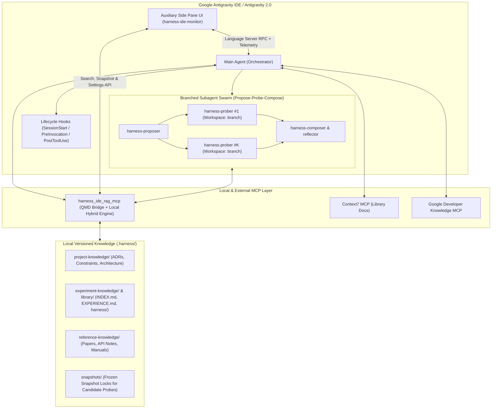

# Architecture Guide: Harness² + Local RAG IDE for Google Antigravity

## 1. System Overview

`harness-ide` transforms Google Antigravity into a self-improving **Recursive Agent Harnessing IDE**. Rather than treating every coding or research session as stateless—or stuffing the entire project history into the prompt—it combines:

1. **Google Research's Harness² (`google-research/harness2`)**: Iterative refinement of the agent's surrounding execution infrastructure (system prompts, rules, skills, subagents, hooks, tools, scripts, plugins) via the **Propose $\rightarrow$ Probe $\rightarrow$ Compose** contrastive loop and an isolated per-domain **Experience Library** (`INDEX.md`, `EXPERIENCE.md`, and complete adopted `harness/` trees).
2. **Local Hybrid RAG (`tobi/qmd` + Built-in Local Hybrid Engine)**: Fast, 100% local indexing and retrieval over versioned Markdown documents using BM25 keyword search, semantic vector similarity, and Reciprocal Rank Fusion (RRF) reranking.
3. **External Documentation Layer (`Context7` + `Google Developer Knowledge`)**: Live, version-accurate library and platform documentation via Model Context Protocol (MCP).
4. **Auxiliary Pane UI Extension (`harness-ide-monitor`)**: A native Antigravity sidecar UI (`SIDECAR_UI_ENTRYPOINT_AUX_PANE`) providing real-time visualization of the Main Agent + Subagent Swarm, Harness² candidate probes, Local RAG search, and an easy-to-understand Settings Manager.

---

## 2. Knowledge Architecture & Provenance Schema

All persistent project and experiment knowledge lives locally in ordinary, git-versioned Markdown files inside `.harness/`. The retrieval index (`.harness/index/` and QMD collections) is treated strictly as a **derived view** of those authoritative files.

### 2.1 Three Core Knowledge Collections

| Collection ID | Path | Contents | When the Agent Queries It |
| :--- | :--- | :--- | :--- |
| `project-knowledge` | `.harness/knowledge/project/` | Architecture Decision Records (ADRs), system requirements, Android frontend & Linux backend constraints, setup guides. | **Before planning** any architectural, feature, or refactoring change. |
| `experiment-knowledge` | `.harness/knowledge/experiments/` & `.harness/library/` | Harness² `INDEX.md` catalog, per-task `EXPERIENCE.md` lessons, failure analyses, training experiment logs, and adopted `harness/` trees. | **Before choosing a strategy** or proposing a harness modification; **after completing** an experiment or probe loop. |
| `reference-knowledge` | `.harness/knowledge/reference/` | Curated paper summaries, hardware manual notes, protocol specifications, benchmark notes. | **When verifying** domain algorithms, hardware constraints, or external specs alongside Context7. |

### 2.2 Provenance Requirements for Every Lesson (`EXPERIENCE.md`)

To prevent "proposed ideas" from being confused with "verified empirical results", every `EXPERIENCE.md` and ADR document uses structured YAML frontmatter and explicit evidence sections answering five questions:

1. **Task / Problem (`task_id`, `problem_statement`)**: What specific task or failure triggered this investigation?
2. **Repository & Revision (`repo`, `git_revision`, `domain`)**: Which repository state and commit SHA did this apply to?
3. **Actual Observation (`observed_behavior`)**: What behavioral shift, metric change, or failure mode was empirically observed across baseline vs. candidate probes?
4. **Supporting Evidence (`evidence_links`, `trajectory_id`, `harness_path`)**: Which execution traces, test outputs, commits, and adopted harness files back the conclusion?
5. **Currency Status (`status: active | candidate | superseded`, `created_at`)**: Is this an adopted conclusion (`active`), an unverified proposal/probe (`candidate`), or an older lesson replaced by newer evidence (`superseded`)?

---

## 3. Consistent Harness² Comparisons via Snapshot Isolation

A critical requirement from Google Research's Harness² (`docs/EXPERIMENTS.md` and `harness2/core/library.py`) is that:
- Tasks within a domain execute sequentially and may only read **earlier** adopted experience entries.
- During a contrastive comparison of $K$ candidate harnesses (`Propose -> Probe -> Compose`), **every candidate must be evaluated against the exact same eligible knowledge snapshot**.

If Candidate #2 could read notes or lessons written during Candidate #1's probe execution, the comparison would be contaminated.

### How `harness-ide` Enforces Snapshot Isolation:
1. **Snapshot Lock Creation (`harness_snapshot_lock`)**: Before spawning candidate probes, the agent (or Harness² adapter) creates a snapshot lock with `cutoff_timestamp` and `git_revision`.
2. **Filtered Retrieval (`harness_query`, `harness_get`)**: While a snapshot lock is active (or when a `snapshot_id` parameter is passed), `harness_ide_rag_mcp` automatically filters out any document or `EXPERIENCE.md` entry created after `cutoff_timestamp` or marked as `status: candidate`.
3. **Branched Workspace Execution**: In Antigravity Swarm Mode, each `harness-prober` subagent is invoked with `Workspace: "branch"`, giving it an isolated copy of the repository tree in addition to the frozen knowledge snapshot.
4. **Post-Composition Promotion**: Only after `harness-composer` compares the $K$ probe trajectories and adopts the winning harness is the new `EXPERIENCE.md` written with `status: active`, added to `INDEX.md`, and indexed for future tasks.

---

## 4. Dual-Level Harness² Execution Integration

As identified in the architectural specification, having Antigravity *manage* Harness² and having Antigravity *execute* Harness² candidate probes are two distinct integration levels. `harness-ide` supports **both**:

### Level 1: Orchestrator Mode (External Harness² CLI / OpenCode / Codex)
- Antigravity manages the workspace, curates `.harness/library/`, and invokes upstream `harness2` (`harness2-demo` or `harness2` benchmark runners) in a Python 3.12+ `uv` environment.
- Both Antigravity and `harness2` share `.harness/library/<domain>/`, and QMD / `harness_ide_rag_mcp` indexes the resulting `INDEX.md` and `EXPERIENCE.md` files automatically.

### Level 2: Native Antigravity Executor Mode (Branched Subagent Swarm + Python SDK Adapter)
- **Native Subagent Swarm (`harness2-loop` Skill)**: Antigravity itself runs the Propose–Probe–Compose loop natively using three specialized subagents (`harness-proposer`, `harness-prober` $\times K$ with `Workspace: "branch"`, and `harness-composer`).
- **Python `AntigravityExecutor` (`adapters/harness2_antigravity_executor.py`)**: A drop-in Python executor class for `google-research/harness2` that translates a Harness² candidate directory (`system_prompt.md`, `rules/`, `skills/`, `subagents/`, `hooks.json`, `mcp_config.json`) into a `google.antigravity.LocalAgentConfig` (or `agy` CLI invocation), runs the probe task, and captures the full trajectory and token/thinking usage metadata for contrastive evaluation.

---

## 5. RAG Backend Comparison & Modularity

The Settings UI (`harness-ide-monitor`) lets the user switch or combine knowledge layers cleanly:

| Layer | Role in `harness-ide` | Local / Cloud | Default State |
| :--- | :--- | :--- | :--- |
| **QMD (`tobi/qmd`) + Built-in Local Hybrid** | Primary local RAG over `.harness/` Markdown & Harness² `INDEX.md`/`EXPERIENCE.md`. | **100% Local** | **Enabled (Primary)** |
| **Context7 (`@upstash/context7-mcp`)** | Live version-specific documentation for external libraries and frameworks. | Remote MCP | **Enabled (External Docs)** |
| **Google Developer Knowledge** | Official Android, Firebase, and Google Cloud documentation. | Remote MCP | **Optional Toggle in UI** |
| **Basic Memory** | Bi-directional editable personal notebook via MCP (`basic-memory`). | Local | **Optional Profile in UI** |
| **RAGFlow** | Heavy PDF, scanned datasheet, and hardware manual ingestion via MCP. | Local Docker / Self-Hosted | **Optional Profile in UI** |
